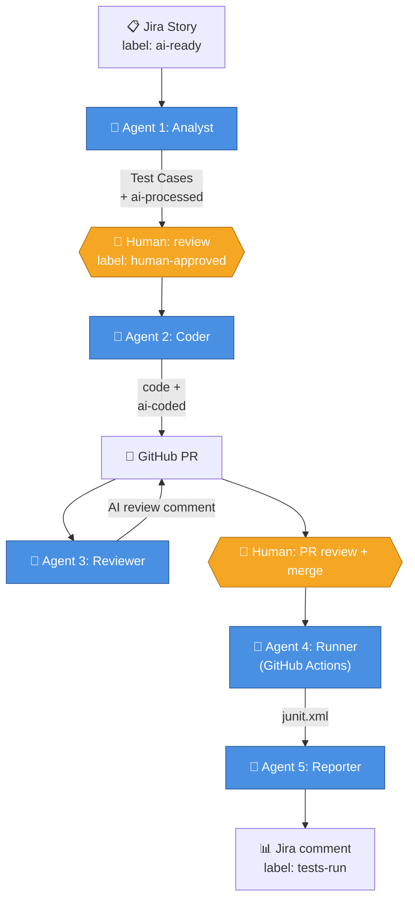

# 🤖 Multi-Agent AI Test Automation

A reusable framework where **5 specialized AI agents** collaborate to automate the entire software testing lifecycle — from requirement analysis to test execution and reporting — with human-in-the-loop checkpoints at every critical step.

> **App-agnostic by design.** This framework was built for SauceDemo as the demo app, but the agent code has zero app-specific knowledge. Onboarding a new application means editing one config block — never agent code.

---

## 📚 Documentation

| Doc | Purpose |
|---|---|
| **[docs/GUIDE.md](./docs/GUIDE.md)** | Architecture, agent deep-dives, configuration, branch naming, human-approval gates, onboarding a new app — **everything in one place** |
| [docs/ARCHITECTURE_DIAGRAM.md](./docs/ARCHITECTURE_DIAGRAM.md) | Mermaid diagrams: pipeline flow, component view, Agent 2 sequence, label lifecycle |
| [docs/APP_INVENTORY_SCHEMA.md](./docs/APP_INVENTORY_SCHEMA.md) | JSON schema for `app_inventory/<app>.json` |
| [docs/ADR-008-pat_for_cascade.md](./docs/ADR-008-pat_for_cascade.md) | Architecture Decision Record: GitHub PAT for cross-workflow cascade |
| [docs/ADR-009-deduplication.md](./docs/ADR-009-deduplication.md) | Architecture Decision Record: Agent 2 dedup engine |
| [CHANGES.md](./CHANGES.md) | Refactor notes — what changed, why, how to adapt |

---

## 🎯 What This Project Does

Given a user story in Jira, this system autonomously:

1. **Reads the requirement** and produces a comprehensive set of manual test cases
2. **Generates automation code** in Playwright + BDD style, opens a Pull Request
3. **Reviews the code** for quality issues, posts comments
4. **Executes the tests** with smart selection (smoke vs full regression)
5. **Reports the results** with AI-summarized failures back to Jira

Each agent has a **human approval gate** — agents propose, humans dispose. This is collaborative AI, not full autonomy.

**Default app under test:** [SauceDemo](https://www.saucedemo.com) — a free, stable demo e-commerce site for automation practice. Swap to your own app via `config.yaml` (see [GUIDE.md → Onboarding a new app](./docs/GUIDE.md#onboarding-a-new-app)).

---

## 🤖 The 5 Agents

| # | Agent | Role | Implementation |
|:-:|---|---|---|
| 1️⃣ | **Analyst** | Reads Jira story → creates manual test cases | `agents/agent1_analyst.py` |
| 2️⃣ | **Coder** | Test cases → Playwright code → opens PR | `agents/agent2_coder.py` |
| 3️⃣ | **Reviewer** | AI code review on the PR | `agents/agent3_reviewer.py` |
| 4️⃣ | **Runner** | Executes tests on PR (CI workflow only — no Python module) | `.github/workflows/agent4_runner.yml` |
| 5️⃣ | **Reporter** | Summarizes results back to Jira | `agents/agent5_reporter.py` |

> **Why is Agent 4 only a workflow file?** It's pure CI orchestration: run pytest, parse junit.xml, upload artifacts. No LLM calls, no API decisions. Putting that logic in Python would just wrap a shell command. The workflow file IS Agent 4. See [GUIDE.md → Agent 4](./docs/GUIDE.md#agent-4-runner-) for details.

---

## 🏗️ Architecture



**Key flow points:**
- Agents communicate via structured state (Pydantic models)
- Each agent stops at a checkpoint — humans review before the next agent runs
- Idempotency labels prevent re-processing the same story twice
- All secrets stay in `.env` (never committed); placeholders live in `.env.example`

For a deeper breakdown — including agent inputs/outputs, design rationale, and the human-approval gate semantics — see [GUIDE.md → Architecture](./docs/GUIDE.md#architecture). For more diagrams (component view, Agent 2 sequence, label state machine), see [ARCHITECTURE_DIAGRAM.md](./docs/ARCHITECTURE_DIAGRAM.md).

---

## 🛠️ Tech Stack

**Everything is free.** No paid services required.

| Layer | Tool | Purpose |
|---|---|---|
| **LLM** | Google Gemini 2.5 Flash | Reasoning engine for all agents |
| **Output validation** | Pydantic | Type-safe schemas for LLM outputs |
| **Test framework** | Playwright + Python | Cross-browser automation |
| **BDD** | pytest-bdd | Gherkin → Python step mapping |
| **Design pattern** | Page Object Model (POM) | Maintainable test code |
| **Project tracking** | Jira Cloud (Free tier) | Stories, Test Cases, workflow gates |
| **Source control** | GitHub | Code + PR-based human gates |
| **CI/CD** | GitHub Actions | Test execution on merge |
| **Reporting** | pytest-html + JUnit XML | Reports to PR + Jira |

LangChain / LangGraph are listed in `requirements.txt` for future orchestration work but are not currently load-bearing — agents are wired together via GitHub Actions workflows, not LangGraph state machines.

---

## 📁 Project Structure

```
multi-agent-test-automation/
│
├── agents/                          # AI agents (numbered by pipeline order)
│   ├── agent1_analyst.py            # Story → Test Cases
│   ├── agent2_coder.py              # Test Cases → Code + PR
│   ├── agent3_reviewer.py           # AI code review
│   ├── agent5_reporter.py           # Result analysis → Jira
│   ├── app_context.py               # AUT config loader (NEW — central decoupling point)
│   ├── jira_client.py               # Jira API wrapper (Adapter pattern)
│   ├── github_client.py             # GitHub API wrapper
│   ├── llm_client.py                # Gemini wrapper with quota handling
│   ├── schemas.py                   # Pydantic data contracts
│   └── test_inventory.py            # Gherkin parsing + dedup + validators
│
├── pages/                           # Page Object Model classes
├── features/                        # Gherkin .feature files
├── tests/
│   ├── conftest.py                  # Playwright fixtures
│   ├── step_defs/                   # Step definitions
│   └── unit/                        # Unit tests for the framework itself
│
├── config/
│   ├── __init__.py                  # Env validation, branch-name helpers
│   ├── paths.py                     # Centralized path resolution
│   └── config.yaml                  # AUT config + agent rules + browser settings
│
├── prompts/                         # Versioned LLM prompt templates
│   ├── agent1_analyst.md
│   ├── agent2_coder_plan.md
│   ├── agent2_coder_generate.md
│   ├── agent3_reviewer.md
│   ├── agent5_reporter.md
│   └── app_context.md               # App-specific context block (NEW)
│
├── app_inventory/                   # JSON descriptions of each AUT
│   └── saucedemo.json
│
├── scripts/
│   └── smoke_test.py                # End-to-end integration check
│
├── .github/workflows/               # CI/CD pipelines
│   ├── agent2_coder.yml
│   ├── agent3-reviewer.yml
│   └── agent4_runner.yml            # Agent 4 + Agent 5 (combined workflow)
│
├── docs/                            # GUIDE + ADRs + schema reference
├── .env.example                     # Secret placeholders (committed)
├── pytest.ini
├── requirements.txt
└── README.md                        # ← You are here
```

---

## 🚀 Getting Started

### Prerequisites
- Python 3.10 or higher (3.11 / 3.13 recommended)
- Jira Cloud Free — [atlassian.com/software/jira/free](https://www.atlassian.com/software/jira/free)
- Google Gemini API key — [aistudio.google.com/apikey](https://aistudio.google.com/apikey)
- GitHub account with a Personal Access Token (PAT)

### 1. Clone and set up Python environment

```bash
git clone https://github.com/rajiniottesting-coder/multi-agent-test-automation.git
cd multi-agent-test-automation

python -m venv venv
# Activate: source venv/bin/activate (Mac/Linux) or venv\Scripts\Activate.ps1 (Windows)
```

### 2. Install dependencies

```bash
pip install --upgrade pip
pip install -r requirements.txt
playwright install chromium
```

### 3. Configure secrets

```bash
cp .env.example .env   # then edit .env with real values
```

See [GUIDE.md → Configuration](./docs/GUIDE.md#configuration) for the full env-var reference.

### 4. Set up Jira

1. Create a Jira project (Scrum template) and note its key (e.g., `SCRUM`)
2. **Project Settings → Work Types** — add a `Test Case` work type
3. Create a sample Story (e.g., `User Login Functionality`)
4. Add the label `ai-ready` to that story

### 5. Verify everything connects

```bash
python scripts/smoke_test.py
```

Expected: 4 ✅ marks confirming env vars, Jira, Gemini, and Playwright all work.

### 6. Run the reference test (sanity check)

```bash
pytest tests/step_defs/test_login.py -v
```

Should open a Chromium window and run 3 login scenarios — all pass.

### 7. Run the agents

```bash
# Agent 1: generate test cases for one story
python -m agents.agent1_analyst --story SCRUM-3 --dry-run
python -m agents.agent1_analyst --story SCRUM-3

# Approve in Jira (add label: human-approved)

# Agent 2: generate code, open PR
python -m agents.agent2_coder --story SCRUM-3 --dry-run
python -m agents.agent2_coder --story SCRUM-3

# Agent 3: review the PR (auto-runs on PR open via GitHub Actions)
python -m agents.agent3_reviewer --pr 5 --dry-run

# Agent 4 + 5: auto-run on PR via GitHub Actions when CI is green
```

For the full lifecycle including approval gates, see [GUIDE.md → Running the pipeline](./docs/GUIDE.md#running-the-pipeline).

---

## 🔁 Onboarding a new application

The whole point of the recent refactor: **no Python code changes** are needed to point this at a new app. The high-level steps:

1. Edit `config/config.yaml` — update the `app_under_test` block (name, base URL, reference files, reserved paths)
2. Drop a new `app_inventory/<your-app>.json` describing pages and selectors ([schema reference](./docs/APP_INVENTORY_SCHEMA.md))
3. Replace `prompts/app_context.md` with your app's known users, error messages, page flow
4. Replace the reference files (`features/login.feature`, `tests/step_defs/test_login.py`, `pages/login_page.py`) with one well-written human-authored test for your app — the LLM uses these as its style baseline

Full step-by-step in [GUIDE.md → Onboarding a new app](./docs/GUIDE.md#onboarding-a-new-app).

---

## 🧪 Running the framework's own unit tests

The framework itself has unit tests (mostly for the dedup engine and validators):

```bash
pytest tests/unit/ -v
```

These tests don't touch Jira, GitHub, or Gemini — fully offline.

---

## 🔐 Secrets Management

Real secrets live ONLY in `.env` (gitignored). The repo ships `.env.example` as a placeholder template.

For CI: GitHub repo Settings → Secrets and variables → Actions. Set the same names listed in `.env.example`.

Full reference: [GUIDE.md → Configuration](./docs/GUIDE.md#configuration).

---

## 🐛 Troubleshooting

Common issues and fixes are in [GUIDE.md → Troubleshooting](./docs/GUIDE.md#troubleshooting). Most-frequent ones:

- **`MissingEnvVarError`** at startup → fill in your `.env` (see `.env.example`)
- **Gemini quota exhausted** → free tier is 20 requests/day; switch model in `.env` or wait ~24h
- **Jira `enhanced_search_issues` not found** → upgrade `jira>=3.10.5` (Atlassian removed the legacy endpoint)
- **`StepDefinitionNotFoundError` at test collection** → Agent 2's validators should catch this; if it slips through, check the auto-correction logs

---

## 🙌 Contributing & Lessons Learned

This project started as a 7-day demo and has been hardened through real PR failures (PR #7's filename mismatch, PR #9's missing decorators, etc.). The patterns we found valuable:

- **Pydantic-validated LLM output** — fail loudly, not silently
- **Two-stage LLM calls** for code generation (plan → per-file content) — much more reliable than one big call
- **Defensive validators** between LLM output and the PR — catches LLM drift before users see it
- **Config-driven everything** — no app-specific code in agents

Contributions welcome via PR. Tests must pass; new validators welcome.
