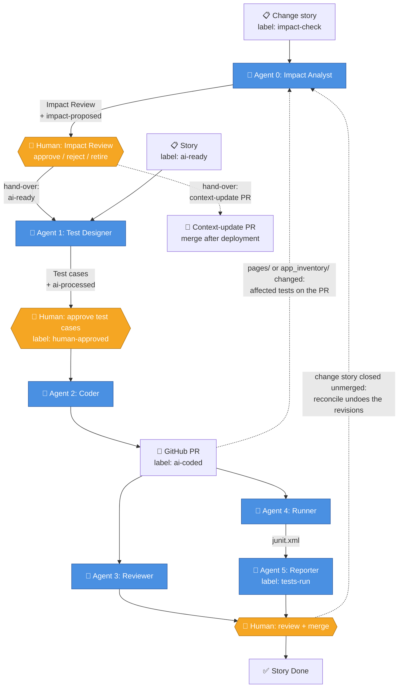

# 🤖 Multi-Agent AI Test Automation

A reusable framework where **six AI agents** turn a Jira story into a reviewed, executed pull request: test cases, Playwright + BDD code, an AI code review, a test run and a report back to Jira. A person stays in control at every gate. When a story **changes** behaviour that existing tests rely on, Agent 0 first finds the affected tests and a person decides what happens to each one.

> **App-agnostic by design.** The agent code has no application-specific knowledge. Everything an application contributes lives in `config/config.yaml`, `app_inventory/<app>.json`, `prompts/app_context/` and the reference trio (one feature, one step-definition file, one page object). Onboarding a new application means editing configuration, never agent code. A unit test harvests the names the application coins (inventory keys, page-object classes and methods, selector fragments) and fails if any framework file uses one.

---

## 📚 Documentation

| Doc | Purpose |
|---|---|
| **[docs/GUIDE.md](./docs/GUIDE.md)** | Architecture (with Mermaid diagrams), Agents 1–5 in depth, change stories (Agent 0), which route a change takes, stories in flight, configuration, sprint scoping, branch naming, human-approval gates, label state machine, onboarding a new app, troubleshooting |
| [docs/AGENT0_ONBOARDING.md](./docs/AGENT0_ONBOARDING.md) | Attaching Agent 0 (impact analysis) to an application, with the readiness check |
| [docs/AI_CONCEPTS.md](./docs/AI_CONCEPTS.md) | AI/LLM concepts used (and deliberately not used), guardrails, demo Q&A, the failure catalogue |
| [docs/DECISIONS.md](./docs/DECISIONS.md) | Architecture Decision Records |
| [docs/REUSE_FOR_NEW_PROJECT.md](./docs/REUSE_FOR_NEW_PROJECT.md) | Checklist for pointing the framework at a new application, incl. the app-inventory JSON schema |
| [docs/TECHNICAL_DEEP_DIVE.md](./docs/TECHNICAL_DEEP_DIVE.md) | Function-level walkthrough of the agents and mechanisms |
| [inventory_tools/inventory_readme.md](./inventory_tools/inventory_readme.md) | Building and maintaining the app inventory (crawl, merge, measure, curate) |
| [docs/VALIDATION_AND_KNOWN_GAPS.md](./docs/VALIDATION_AND_KNOWN_GAPS.md) | What has been validated live, the validation runs still to do, and every known gap with its status and planned fix |
| [CHANGES.md](./CHANGES.md) | Changelog — what changed, why, how to adapt |

---

## 🎯 What it does

**A new story** (label `ai-ready`):

1. **Agent 1** reads the story and its module context and drafts the fewest test cases that cover it, as Jira Test Case issues, with a coverage map naming the test that verifies each acceptance criterion
2. 🛑 **A person approves** the test cases (label `human-approved`)
3. **Agent 2** plans the code, writes it one file at a time, runs the static validators, repairs what fails, and opens a pull request (it waits instead if another open PR is changing a file it would write)
4. **Agent 3** reviews the diff; **Agent 4** runs the unit suite and the BDD tests on the PR (browser runs take turns across PRs); **Agent 5** posts the verdict and the cost back to Jira
5. 🛑 **A person merges** the pull request — only a merge moves the story to Done

**A change story** (label `impact-check`) goes through **Agent 0** first: it traces the change to the existing tests it affects, ranks them with evidence and opens an **Impact Review**. 🛑 A person decides each test (approve, reject or retire). At the next scan Agent 0 hands the decisions over and opens a separate **context-update PR** for the reference material the change makes stale. Agent 1 then revises the approved tests in place and adds only uncovered cases, Agent 2 splices the revised scenarios into the files that own them, and Agent 5 scores how well Agent 0 predicted the impact. If the story's PR is closed without merging, Agent 0's **reconcile** undoes every revision.

**Agent 0 also watches the code and the live app:** every PR touching `pages/` or `app_inventory/` gets a comment listing the tests its changes affect, and a nightly drift check turns a selector that stopped matching into the list of affected tests.

**Reworking a coded story:** `ai-update` splices only the scenarios whose test cases changed, were added or were deleted; `ai-regenerate` rewrites the story's code on a fresh `-revN` branch.

**Fixing what a reviewer asks for:** a "Request changes" review on an Agent 2 pull request, or a `/fix <what to change>` comment, makes Agent 2 change the files the comments point at, run the same checks as a new pull request and push to the same branch - Agents 3, 4 and 5 then run again. A comment asking to test something the approved test cases do not state is declined: change the test case, then `ai-regenerate`.

The pipeline never merges its own code. Agents propose; people decide.

**Default app under test:** [Automation Exercise](https://automationexercise.com) — a free demo e-commerce site. Swap to your own app via `config.yaml` (see [Onboarding a new application](#-onboarding-a-new-application)).

---

## 🤖 The six agents

| # | Agent | Role | Implementation | Model calls |
|:-:|---|---|---|---|
| 0️⃣ | **Impact Analyst** | Change story → the tests it affects, ranked, in an Impact Review; hand-over, context-update PR and reconcile (finish or undo); PR code-change and nightly drift checks | `agents/agent0_impact.py` + `core/impact_*.py`, `core/context_update.py` | 2 to analyse (+1 per extra batch past 300 candidates); up to 2 for the context update; 0 on PR code-change and drift runs |
| 1️⃣ | **Test Designer** | Story → Test Case issues carrying the story's Components, every acceptance criterion mapped to the test that verifies it; impact-aware mode revises approved tests | `agents/agent1_analyst.py`, `agents/agent1_impact.py` | 1 (+1 if a rule fails) |
| 2️⃣ | **Coder** | Test cases → plan → code per file → validated PR; splices change-story scenarios; fixes what a PR's reviewer asks for | `agents/agent2_coder.py`, `agents/agent2_impact.py`, `agents/agent2_review_fix.py` | 1 plan + 1 per file (+ repairs); a change story adds 1 per revised scenario and up to 1 per owner step file; a review fix: 1 to decide + 1 per changed file |
| 3️⃣ | **Reviewer** | AI code review of the PR's changed lines | `agents/agent3_reviewer.py` | 1 |
| 4️⃣ | **Runner** | Unit suite, then pytest-bdd + Playwright on the PR; browser runs take turns across PRs, and a PR changing only prompts, docs or Markdown runs the unit suite only | `.github/workflows/agent4_runner.yml` | 0 |
| 5️⃣ | **Reporter** | Results and cost to Jira; scores Agent 0 on change stories | `agents/agent5_reporter.py` | 1 |

**Model calls per story, with no repairs:**

| Story | Calls | Breakdown |
|---|---|---|
| New story (`ai-ready`) | **7** | Agent 1: 1 draft · Agent 2: 1 plan + 1 per generated file (typically 3) · Agent 3: 1 review · Agent 5: 1 report |
| Change story (`impact-check`), e.g. A3 | **about 14–15** | Agent 0: 2 to analyse + 2 for the context update · Agent 1: 1 impact-aware draft · Agent 2: 1 plan + 1 per new file (typically 3) + 1 per revised scenario (2) + 0–1 for the owner's step file · Agent 3: 1 on the story PR + 1 on the context-update PR · Agent 5: 1 (none for the context-update PR, which runs no browser) |

Add one call per repair attempt and per corrective retry. Every push to an open PR runs Agents 3 and 5 again (one call each). A story that waits for another open PR (see below) has spent its plan call and spends it again on the retry. The measured total is on the story, in Agent 5's end-to-end cost table - except Agent 3's review of the context-update PR, whose branch carries no story key, so its cost appears only in that run's log.

> **Why is Agent 4 only a workflow?** It is pure CI: run pytest, collect junit.xml, screenshots, videos and traces, upload the reports. No model calls and no decisions. Agents 4 and 5 share one workflow. See [GUIDE.md → Agent 4](./docs/GUIDE.md#agent-4-runner).

---

## 🏗️ Architecture

There is no orchestrator. Each agent runs in its own CI job, minutes or hours apart, and the state lives in **Jira labels, marker comments and the pull request** — visible on the board and safe if a runner is killed.



**Key points**
- **Labels are the state machine:** `ai-ready → ai-processed → human-approved → ai-coded → tests-run`. A change story enters earlier: `impact-check → impact-proposed →` (Impact Review Done, hand-over) `→ ai-ready`, then `impact-applied` until its PR merges or closes (`impact-reverted` after an undo); retired test cases carry `ai-retired`; the drift job's maintenance story carries `inventory-drift`. `ai-update` and `ai-regenerate` are one-shot triggers, removed when the run succeeds; `ai-skip` hides a story from every agent. Idempotency labels stop a story being processed twice, and Agent 0 skips a story whose text it has already analysed.
- **The board follows the work** (`status_workflow` in config): `ai-processed` → In Progress, `ai-coded` → In Review, `impact-reverted` → To Do (an undone change story, ready to retry), a merged PR → Done (`story_done_on_merge.yml`). No label maps to Done.
- **Agents 1 and 2 run on a business-hours cron** (every 30 min, weekdays 10:00–19:00 IST); Agent 0 scans weekdays at 10:45 IST (analysis, hand-over and reconcile), checks every PR touching `pages/` or `app_inventory/`, and runs a nightly drift check at 07:15 IST; Agents 3–5 run on PR events, and Agent 2's review fix on a "Request changes" review or a `/fix` comment; a **sweeper** re-triggers, hourly in business hours, PRs whose CI never started.
- **CI storage stays inside the free quota:** Agent 4 uploads only the files Agent 5 needs, kept 3 days, and `artifact_cleanup.yml` deletes artifacts older than 2 days, daily.
- **A change story's state is in Jira too:** Agent 0's report and Impact Review sub-task, Agent 1's snapshot of each revised test, trace comments on the owning stories and reconcile's markers are all issues or comments, so an undo needs no database. Every such comment starts with a marker (`[agent0:report]`, `[agent0:snapshot]`, `[LLM-USAGE]`, …): [GUIDE.md → Marker comments](./docs/GUIDE.md#marker-comments).
- **Two Protocols keep the tools swappable:** `Tracker` (23 operations, Jira adapter today) and `RepoHost` (19 operations, GitHub adapter today). Nothing in `agents/` talks to Jira or GitHub directly, and a unit test runs the whole pipeline against fakes of both.
- Secrets stay in `.env` (never committed) and CI secrets; placeholders live in `.env.example`.

Deeper breakdown: [GUIDE.md → Architecture](./docs/GUIDE.md#architecture).

---

## 🔍 Agent 0 — change impact

Agent 0 answers *"which existing tests does this change touch?"* before any test is rewritten.

**Three triggers** (`.github/workflows/agent0_impact.yml`)

| Trigger | When | What happens |
|---|---|---|
| Story label `impact-check` | Weekdays 10:45 IST, or a manual run | Two model calls (seeds, then judgement; one more per batch past 300 candidates); a report, or an Impact Review |
| Pull request | Any PR touching `pages/` or `app_inventory/` | Compares page-object methods and selectors with `main`, no model; posts the affected tests on the PR |
| Nightly drift | After the inventory staleness check (07:15 IST), or on demand (`mode` = `drift`) | A selector that stopped matching is traced to the affected tests, no model; live mode opens one maintenance story (label `inventory-drift`) and updates it on later nights |

**Manual run inputs** (Run workflow): `story_key` analyses and reconciles that one story (blank = everything); `dry_run` makes **every** job print what it would write and write nothing - analysis, hand-over, reconcile and drift; `mode` = `drift` runs the drift job only and refuses a `story_key`.

Two more jobs run on the scheduled scan and on **every** manual run in `scan` mode: the **hand-over** of decided Impact Reviews (only in a full scan — a run with `story_key` set analyses that story and does not hand over) and **reconcile**, in its own job (below).

**What a seed is — by trigger**

| Trigger | Element seeds | Page-method seeds | Changed behaviours |
|---|---|---|---|
| Story | From the story text (model), each checked against the inventory | None — reached through the graph | From the story text |
| Pull request | Selector changed or removed | Body or signature changed, or removed | None |
| Nightly drift | Missing or ambiguous on the live site | None | None |

Anything only **added** is never a seed: new code cannot break an existing test.

**How a story is analysed**
1. **Stage 0:** skip a story whose text has not changed since the last live analysis (no model call).
2. **Seeds** (`ChangeSeeds`): the model classifies the change and names the elements and behaviours it changes; element keys not in the inventory are dropped. A story classified `new_behaviour` — new functionality, or a new journey through existing behaviour — keeps **no** seeds: using a behaviour is not changing it.
3. **Candidates:** Layer 1 traces each element seed through the **impact graph** (scenario → step → page method → selector); Layer 2 adds scenarios of the story's Component by topic. Up to `max_candidates` (300) are judged — Layer 1 always, Layer 2 fills the rest; any beyond are listed as *not judged*, never as unaffected.
4. **Judgement** (`ImpactAssessment`): the model judges each candidate against the changed behaviours, citing a graph path or a verbatim step; a verdict citing neither is dropped.
5. **Rank:** `0.45·structural + 0.15·component + 0.15·semantic + 0.25·verdict` — **must-update ≥ 0.6, review ≥ 0.3** — never above the model's own verdict.

**Modes** (`agents.agent0_impact` in `config.yaml`): **off** (`enabled: false`, the framework default), **shadow** (`shadow_mode: true` — a report comment only: `impact-check` is removed and no label added, so Agent 0 can be scored before it writes anything) and **live** (an Impact Review sub-task and `impact-proposed`). This repository runs **live** for validation stories. To stop everything at once, disable the workflow in GitHub Actions. An optional `uncovered_hint` (off by default) adds a page whose element the story names but no selector covers, as a review-tier candidate.

**Lifecycle of a change story**

```
impact-check → impact-proposed → Impact Review Done → ai-ready → impact-applied → merged | impact-reverted
```

- **Hand-over** (next full scan after the review is Done and every row decided): Impacts links to the approved tests and their owners, `ai-retired` on retired tests, a trace comment on each owning story, then `ai-ready`. If nothing needs review, the story goes straight to `ai-ready` (and the context update runs then).
- **Agent 1, impact-aware:** snapshots each approved test, revises it in place, adds only the cases its coverage map shows are missing (a criterion that removes something is covered only by a step asserting it is gone), flags a revision that repeats an existing scenario, records `Change applied at: <UTC>`, and labels the story `impact-applied`.
- **Agent 2:** splices each revised scenario into the feature file that owns it and removes retired ones, leaving every other scenario byte-identical; the owners' files are never generated whole, and step functions the change left unused are commented out.
- **Context update:** at hand-over (up to two model calls) Agent 0 opens a separate PR that updates the inventory and the app notes — wording the story replaces, and passages the story makes untrue (behaviour, rules, removed elements). A wording change can update a text-based selector (flagged to verify after deployment); a note rewrite never touches a selector. Merge it after the change is deployed. Its branch carries no story key, so it never closes the story. No PR is opened when nothing is stale; a PR that changes only notes runs the unit suite but no browser.
- **Outcome:** Agent 5 scores the prediction on the story — **recall** (of the tests the PR actually changed, how many Agent 0 flagged) and **precision** (of the tests flagged, how many really changed).
- **Reconcile** (runs whatever the mode, only on stories labelled `impact-applied`): a merged PR closes the loop. A PR closed without merging is undone once `reconcile.closed_scans` scans (default 2) have seen it still closed, so a sweeper close-and-reopen is never mistaken for a rejection: each revised test's earlier text is restored, retired tests are un-retired, the links are removed, the story's own tests that never reached main are retired, the pipeline labels are reset, the review is marked undone, the card moves back to To Do and the retry steps are posted. A story labelled `impact-applied` with no PR for 14 days (`no_pr_days`) gets an ask-a-person comment. Only PRs opened after `Change applied at` count, so to retry an undone story you remove `impact-reverted` and add `impact-check`: it is analysed afresh as a new attempt.

Attaching Agent 0 to another application: [docs/AGENT0_ONBOARDING.md](./docs/AGENT0_ONBOARDING.md) and `python -m scripts.onboarding_check`.

---

## 🛡️ What keeps it honest

- **Every acceptance criterion is verified by a test that can fail.** Agent 1 reads the criteria from the story itself and must map each one to the test that verifies it; a criterion that removes, renames, hides or restricts something, or sets a limit, needs a step asserting the old thing is gone, the refusal or the rejection - a test that merely stops using a removed field passes whether or not it was removed. Agent 2 must keep that step in the scenario, assert it in the step definition, and check a removed element's absence on a page proven loaded (`core/acceptance_coverage.py`, `validators/absence_claims.py`).
- **A 32-check static validator gate before any branch exists.** A failure becomes a targeted repair prompt naming the file and the rule; only the broken files are regenerated (up to 4 attempts), and the loop stops early when an attempt changes nothing, when the same rules keep failing, or when a regeneration comes back worse. Every repairable error is routed to the generated file it names, however a rule words it, so no error reaches the final gate without a repair attempt.
- **Real signatures, not guesses.** BasePage's 86 helpers and every sibling page object's methods are read from source by AST and handed to the next file's prompt. A Then step another feature already defines is shown with its committed body, so it keeps the same meaning in every feature. The change-story splice writers get the same grounding plus one corrected retry, and a contract test fails any new model writer without it.
- **Typed model boundaries.** 24 Pydantic schemas (TestCaseList, CodePlan, ReviewReport, ChangeSeeds, ImpactAssessment and more); a malformed reply gets one repair attempt, then fails.
- **Reviewer that must name a failure.** Agent 3 is checked out from main, flags only changed lines, blocks only for a named failure scenario, and Agent 4's run on the same commit refutes a predicted failure - all of them when the run is green, and when it is red, each one whose own scenario passed (read from the run's junit report) - when that run executed the app tests (a PR changing only prompts, docs or Markdown runs none, so it refutes nothing). The BasePage helpers the changed page objects call are shown to it with their docstrings, so a claim about what a helper does is checked against what the helper says.
- **Stories in flight do not collide.** Agent 2 never writes a file another open PR is changing, and never generates a scenario another open PR already adds: the story waits and the next scan retries (`core/in_flight.py`). Agent 4's browser runs take turns across PRs, because every PR tests the same live application with the same accounts (`scripts/e2e_turn.py`).
- **Agent 0 proves its verdicts.** A verdict that cites no real graph path or verbatim step is dropped, an element the inventory does not have is dropped, and the score can never rank a test above the model's own verdict. A person approves every revision, and every revision can be undone from its snapshot.
- **No duplicates.** Agent 1 refuses a story that already owns test cases; Agent 2 skips a test case a scenario already covers (marker first, then title without the `[type]` tag).
- **Prompt caching.** The static rule text of the generation prompt is sent as a cacheable prefix; per-file content goes in the user message.
- **Failure evidence.** A failed test carries a plain-English cause and remedy plus its screenshot, video and Playwright trace in the Allure report.
- **Cost on the story.** Every model-using agent, Agent 0 included, posts its token and cost ledger to the Jira story; Agent 5 totals it. Reprocessing posts a ledger boundary, so a rerun is not double-counted.
- **Business-level stories.** Acceptance criteria state outcomes; Agent 1 takes concrete test data from `core.md` and is forbidden to invent any.

---

## 🛠️ Tech stack

| Layer | Tool | Purpose |
|---|---|---|
| **LLM** | Any OpenAI-compatible endpoint (e.g. a LiteLLM gateway), model set by `LLM_MODEL` | Reasoning for Agents 0, 1, 2, 3 and 5 |
| **LLM transport** | `langchain-openai` / `langchain-core` (ChatOpenAI and message types only) | HTTP transport — no chains, memory, agents or LangGraph |
| **Output validation** | Pydantic 2 | Typed schemas at every model boundary |
| **Test framework** | Playwright + Python | Browser automation |
| **BDD** | pytest-bdd | Gherkin → Python step mapping |
| **Design pattern** | Page Object Model | Selectors resolved by key from the inventory (`self.sel("key")`) |
| **Tracker** | Jira Cloud (adapter behind the `Tracker` Protocol) | Stories, Test Cases, labels, Impact Reviews |
| **Code host** | GitHub (adapter behind the `RepoHost` Protocol) | Branches, PRs, PR-based human gates |
| **CI** | GitHub Actions (10 workflows) | Agents 0–5, Agent 2's review fix, inventory health, Done on merge, sweeper, artifact cleanup |
| **Reporting** | Allure, pytest-html, JUnit XML | Reports on the PR and in Jira |

Prompts are Markdown files under `prompts/`, filled by plain string replacement — versioned and reviewable in a PR.

---

## 📁 Project structure

```
multi-agent-test-automation/
├── agents/                          # The agents (numbered by pipeline order)
│   ├── agent0_impact.py             # Impact Analyst: scan, PR code change, drift
│   ├── agent1_analyst.py            # Test Designer: story → Test Case issues
│   ├── agent1_impact.py             # Impact-aware mode: revise approved tests, snapshot first
│   ├── agent2_coder.py              # Coder: plan → per-file generation → validate/repair → PR
│   ├── agent2_impact.py             # Change-story revise/retire splice in owners' files
│   ├── agent2_review_fix.py         # Fixes what a PR's reviewer asks for (same branch, same gate)
│   ├── agent3_reviewer.py           # Reviewer
│   └── agent5_reporter.py           # Reporter (+ Agent 0 scoring)
│
├── core/                            # Shared infrastructure
│   ├── llm_client.py                # OpenAI-compatible client, retries, structured output
│   ├── schemas.py                   # Pydantic contracts between agents
│   ├── usage_ledger.py              # Token and cost ledger per story
│   ├── app_context.py               # AUT config loader + component-wise inventory filtering
│   ├── test_case_rules.py           # Rules every drafted test case must follow
│   ├── acceptance_coverage.py       # Every acceptance criterion verified; removals need an absence step
│   ├── board_status.py              # Board column automation
│   ├── dry_run.py                   # Dry run: real code, adapters that make no writes
│   ├── in_flight.py                 # Files and scenarios other open PRs are changing (Agent 2 waits)
│   ├── test_runtime.py              # Can a change alter a test result? (Agent 4 PR gate, Agent 3)
│   ├── failure_diagnosis.py         # Raw failure → plain-English cause + remedy
│   ├── allure_meta.py, allure_steps.py
│   ├── impact_graph.py              # Agent 0: scenario → step → method → selector graph
│   ├── impact_analysis.py           # Agent 0: seeds → candidates → judgement → ranking
│   ├── impact_review.py             # Agent 0: the Impact Review sub-task
│   ├── impact_handover.py           # Agent 0: hand-over of a decided review
│   ├── impact_reconcile.py          # Agent 0: finish or undo a change story
│   ├── impact_trace.py, impact_results.py, impact_settings.py
│   ├── context_update.py            # Agent 0: context-update PR (wording + untrue passages)
│   ├── inventory_proposals.py       # Reviewable inventory additions
│   ├── json_block.py                # Reads JSON stored in tracker code blocks, in every format
│   └── onboarding.py                # Agent 0 readiness for another application
│
├── integrations/                    # Tool adapters behind two Protocols
│   ├── tracker.py, repo_host.py     # The Protocols
│   ├── jira_client.py, jira_markup.py
│   └── github_client.py
│
├── validators/                      # Static checks run before a PR is opened
│   ├── gherkin_analyzer.py          # Gherkin parsing, structure, dedup
│   ├── import_validator.py          # Imports resolve to real modules and symbols
│   ├── method_resolution_validator.py  # Page-object methods, selectors, waits, probes
│   ├── page_object_contract.py      # An extended page object keeps its methods
│   ├── orphan_cleanup.py            # Step defs and methods left behind by an edit
│   └── absence_claims.py            # An absence step is kept, asserted, and checked on a loaded page
│
├── inventory_tools/                 # App-agnostic inventory generation + staleness
├── pages/                           # Page objects (base_page.py = shared helpers)
├── features/                        # Gherkin feature files
├── tests/
│   ├── step_defs/                   # Step definitions (+ shared steps in conftest.py)
│   └── unit/                        # The framework's own offline unit suite
│
├── config/                          # config.yaml, env validation, paths
├── prompts/                         # Prompt templates (agent0_*, agent1_*, agent2_*, …)
│   └── app_context/                 # core.md + one module per Jira Component
├── app_inventory/                   # Pages, selectors, notes, components of the AUT
│
├── scripts/
│   ├── smoke_test.py                # Env, tracker, LLM and Playwright connectivity check
│   ├── generate_inventory.py, promote_draft.py, verify_locators.py
│   ├── check_inventory_staleness.py, apply_inventory_proposals.py
│   ├── sweep_stalled_prs.py, close_merged_story.py, cleanup_artifacts.py
│   ├── impact_handover.py, impact_reconcile.py, backfill_markers.py
│   ├── agent0_backtest.py, onboarding_check.py, gateway_probe.py
│   ├── e2e_turn.py                  # Agent 4: wait for earlier PRs' browser runs
│
├── .github/workflows/
│   ├── agent0_impact.yml            # Scan, reconcile, PR code change, nightly drift
│   ├── agent1_analyst.yml
│   ├── agent2_coder.yml
│   ├── agent2_review_fix.yml        # "Request changes" review or /fix comment → Agent 2 fixes the PR
│   ├── agent3-reviewer.yml
│   ├── agent4_runner.yml            # Agent 4 + Agent 5
│   ├── artifact_cleanup.yml         # Daily: delete old Actions artifacts (storage quota)
│   ├── inventory_health.yml         # Nightly selector check against the live app
│   ├── story_done_on_merge.yml      # Only a human merge moves a story to Done
│   └── sweeper.yml                  # Re-triggers stalled PRs
│
├── docs/
├── .env.example
├── pytest.ini
└── requirements.txt
```

---

## 🚀 Getting started

### Prerequisites
- Python 3.10+ (CI uses 3.13)
- Jira Cloud — [atlassian.com/software/jira/free](https://www.atlassian.com/software/jira/free)
- An OpenAI-compatible LLM endpoint (`OPENAI_API_KEY`, `OPENAI_API_BASE`, `LLM_MODEL`)
- A GitHub Personal Access Token

### 1. Clone and create an environment

```bash
git clone https://github.com/rajiniottesting-coder/multi-agent-test-automation.git
cd multi-agent-test-automation
python -m venv venv
# Activate: source venv/bin/activate (Mac/Linux) or venv\Scripts\Activate.ps1 (Windows)
```

### 2. Install dependencies

```bash
pip install --upgrade pip
pip install -r requirements.txt
playwright install chromium
```

### 3. Configure secrets

```bash
cp .env.example .env   # then fill in real values
```

Full reference: [GUIDE.md → Configuration](./docs/GUIDE.md#configuration).

### 4. Set up Jira

1. Create a Jira project (Scrum template) and note its key (e.g. `SCRUM`)
2. Add a `Test Case` work type. For Agent 0 also: an `Impacts` issue link type (outward "impacts", inward "is impacted by") and the `Subtask` type for the Impact Review (names in `config.yaml`: `link_types`, `agents.agent0_impact.review`)
3. Create Components matching `prompts/app_context/*.md` (e.g. Login, Cart) — the story's Component selects the module context and the inventory pages
4. Create a Story and add the label `ai-ready`
   (to rework an already-coded story: `ai-update` = surgical sync after Test Case changes, `ai-regenerate` = full rewrite; for a change story: `impact-check` — see [GUIDE.md → Label semantics](./docs/GUIDE.md#label-semantics))

### 5. Verify connectivity

```bash
python scripts/smoke_test.py
```

Checks env vars, the tracker (including the `Test Case` type), the LLM endpoint and Playwright.

### 6. Run the reference test

```bash
pytest tests/step_defs/test_login.py -v
```

Runs the five login scenarios in Chromium.

### 7. Run the agents locally

```bash
# Agent 0: analyse one change story (labelled impact-check)
python -m agents.agent0_impact --story SCRUM-3 --dry-run
# Agent 0: full scan - analyses, then hands over decided Impact Reviews (dry run prints the writes)
python -m agents.agent0_impact --scan --dry-run
# Agent 0: reconcile (finish or undo) stories labelled impact-applied
python -m scripts.impact_reconcile --story SCRUM-3 --dry-run

# Agent 1: test cases for one story
python -m agents.agent1_analyst --story SCRUM-3 --dry-run
python -m agents.agent1_analyst --story SCRUM-3

# Approve in Jira (label: human-approved)

# Agent 2: code + PR  (--update for an incremental splice)
python -m agents.agent2_coder --story SCRUM-3 --dry-run
python -m agents.agent2_coder --story SCRUM-3

# Agent 3: review a PR
python -m agents.agent3_reviewer --pr 5 --dry-run

# Agent 2: fix what a PR review asked for (review text in REVIEW_FIX_TEXT)
python -m agents.agent2_review_fix --pr 5 --review-id 123456 --dry-run

# Agents 4 + 5 run on the PR in GitHub Actions
```

In CI the agents run in scan mode (`--scan`) on their schedules. Full lifecycle: [GUIDE.md → Running the pipeline](./docs/GUIDE.md#running-the-pipeline).

---

## 🔁 Onboarding a new application

No Python changes are needed to point the framework at a new app:

1. **`config/config.yaml`** — the `app_under_test` block (name, base URL, inventory path, reference trio, reserved paths) and the Agent 0 mode.
2. **`app_inventory/<your-app>.json`** — pages and selectors ([schema](./docs/REUSE_FOR_NEW_PROJECT.md#app-inventory-json-schema)). Build it with the tooling — crawl, merge, measure, then curate ([full sequence](./docs/GUIDE.md#inventory-tooling--the-full-sequence)). Curation cannot be automated: a crawler records what a page contains, never what it means.
3. **`prompts/app_context/`** — `core.md` (users by role, known data, page flow, business phrases → real values) plus one `<component>.md` per Jira Component. Agent 1 reads only these modules, never the inventory.
4. **The reference trio** — replace `features/login.feature`, `tests/step_defs/test_login.py` and `pages/login_page.py` with one well-written test for your app; the model uses them as its style baseline.
5. **Agent 0 (optional)** — `components` on every inventory page, a `# JIRA:` marker above every scenario (`scripts.backfill_markers` proposes them), the `Impacts` link type, then shadow mode before live. `python -m scripts.onboarding_check` reports what is missing ([docs/AGENT0_ONBOARDING.md](./docs/AGENT0_ONBOARDING.md)).

The framework was moved from an Angular HR system to this e-commerce application without editing a single agent.

### Inventory Health (nightly)

`.github/workflows/inventory_health.yml` runs `verify_locators` against the live application every night (02:30 UTC) and on demand, across every page in the inventory. It is the only check that proves a selector still **resolves** — the unit suite proves the inventory is structurally sound, but cannot know that a selector still matches a site someone else deploys. It reports and never auto-fixes: a regenerated draft would lose the curated `elements_notes`, `multi_match` and `conditional` markers. Agent 0's nightly drift job turns a broken selector into the list of affected tests.

---

## 🧪 The framework's own unit tests

```bash
pytest tests/unit/ -q   # ~3,000 offline tests, about 2 minutes; no Jira, GitHub or LLM needed
```

They cover the agents' logic, every validator, Agent 0's graph, ranking, review, hand-over, context update and reconcile, the stories-in-flight guards, the inventory tooling, the sweeper, the Protocol contracts (the whole pipeline against a fake tracker and repo host) and the golden-rule guard that keeps application names out of framework files (`test_committed_tree_resolves.py`). Agent 4 runs them on every PR before the BDD tests.

---

## 🔐 Secrets

Real secrets live only in `.env` (gitignored); `.env.example` is the template. In CI set them under **Settings → Secrets and variables → Actions**:

| Kind | Names |
|---|---|
| **Secrets** | `JIRA_EMAIL`, `JIRA_API_TOKEN`, `OPENAI_API_KEY`, `GH_PAT` (a personal token: PRs it opens trigger the other workflows, which `GITHUB_TOKEN` cannot), `APP_USER_REGISTERED`, `APP_PASSWORD` |
| **Variables** | `JIRA_URL`, `JIRA_PROJECT_KEY`, `JIRA_BOARD_ID`, `GH_REPO`, `OPENAI_API_BASE`, `LLM_MODEL`, optional `LLM_MODEL_LIGHT`, `LLM_PRICE_INPUT_PER_1M`, `LLM_PRICE_OUTPUT_PER_1M` |

Credentials for the application under test come from CI secrets only. Full reference: [GUIDE.md → Configuration](./docs/GUIDE.md#configuration).

---

## 🐛 Troubleshooting

More in [GUIDE.md → Troubleshooting](./docs/GUIDE.md#troubleshooting). The most frequent:

- **`MissingEnvVarError`** at startup → fill in `.env` (see `.env.example`)
- **LLM quota or rate limit** → the run fast-fails (`QuotaExhaustedError`), labels stay unconsumed, and the next cron tick retries
- **Jira `enhanced_search_issues` not found** → upgrade to `jira>=3.10.5`
- **`StepDefinitionNotFoundError` at collection** → the validators should catch this; check the repair-loop log in the Agent 2 run
- **A PR never got Agents 3–5** → the hourly sweeper re-triggers it, or re-run the workflow manually
- **A reviewer's comment was not acted on** → only a "Request changes" review or a comment starting with `/fix`, from someone with write access, starts Agent 2's review fix, and only on an `auto/*` pull request. Its `[agent2:review-fix]` comment on the PR lists each comment's outcome; a declined one says why (another story's file, or a change to what the test cases state)
- **Agent 2 shows `[WAIT]` for a story** → another open PR is changing one of its files or adds one of its scenarios; the story's `[agent2:waiting]` comment names it. It continues on the first scan after that PR merges or closes
- **Agent 2 shows `[BLOCK]` for a story** → its final gate refused the story earlier and nothing has changed since; the `[agent2:blocked]` comment lists the rules. Edit the test case it names (the next scan retries) or run Agent 2 with the story key
- **No Agent 5 report on a PR** → expected when the PR changes only prompts, docs or Markdown (no browser run); otherwise check the branch carries the story key
- **Agent 0 did nothing for a story** → check the mode in `config.yaml` (off by default) and that the story carries `impact-check`; an unchanged story is skipped on purpose
- **A decided Impact Review was not handed over** → run Agent 0 with `story_key` blank; a one-story run does not hand over. An unreadable or undecided review leaves the story waiting, with the reason in the log
- **A change story's PR was closed but the tests still show the revised text** → reconcile undoes it once `closed_scans` scans (default 2) have seen the close; the first scan only posts `[agent0:reconcile] closed-unmerged`
- **Agent 4's log says "waiting for earlier run(s)"** → another PR's browser run started first; runs take turns (capped at 15 minutes)
- **A test failed with `HTTP 503` (or another 5xx / 429) from the application** → the site refused the CI runner for a moment while it loads fine in a browser. Page loads are already retried (`browser.navigation_retry_delays_ms`, 3 s then 8 s) and Agent 4 re-runs a test whose failure names a 5xx/429 - or whose own request got one and was never answered - up to twice, 20 s apart; still failing means the outage lasted longer - re-run the job
- **Actions blocked: storage quota** → artifacts count against the account's storage; `artifact_cleanup.yml` (or `python -m scripts.cleanup_artifacts --yes`) deletes artifacts older than 2 days

---

## 🙌 Lessons learned & contributing

The framework has been hardened through real failures, each fixed generically and pinned by unit tests. The recurring pattern: the failure produced **plausible-but-wrong output** rather than an obvious error. What proved valuable:

- **Pydantic-validated model output** — fail loudly, not silently
- **Plan, then one file at a time** — far more reliable than one big call
- **Validators between the model and the PR** — prompts ask, validators enforce
- **State in labels and comments, not memory** — any run can die and the next one carries on
- **A person at every gate** — the model finds what needs changing; a human approves the list
- **Every change reversible** — snapshots before revising, so a rejected change story is undone, not hand-repaired
- **Config-driven everything** — no application-specific code in the framework

Contributions welcome via PR. The unit suite must pass; new validators are welcome.
