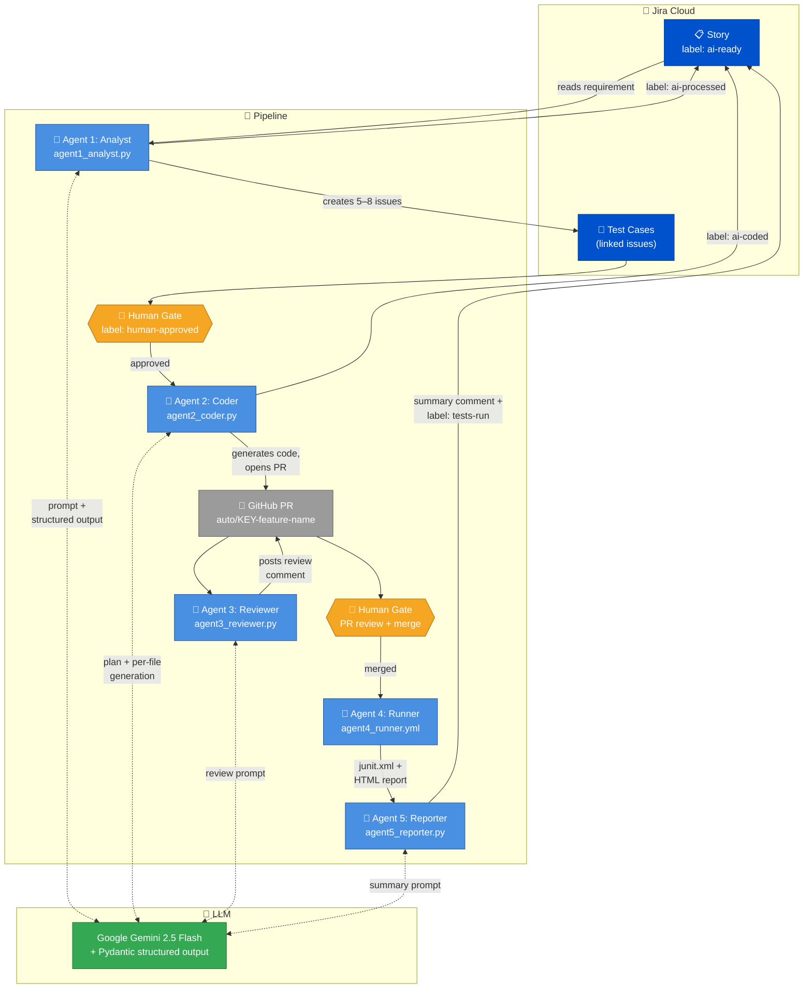
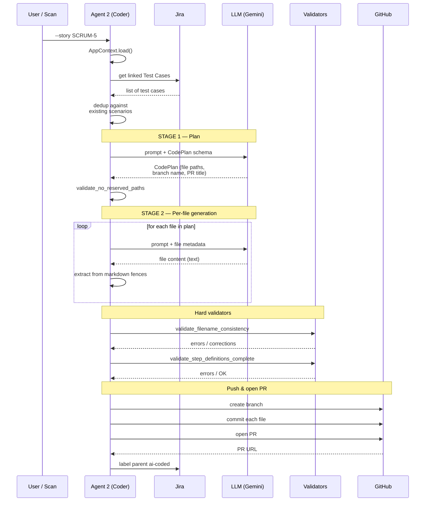
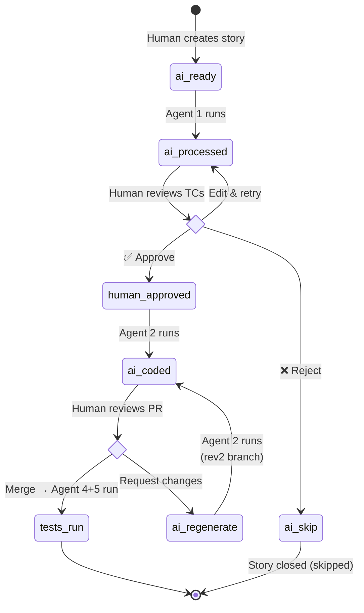

# Architecture Diagram

This file renders natively on GitHub when viewed in the browser. The Mermaid source is also valuable on its own — paste it into [mermaid.live](https://mermaid.live) to edit.

## Pipeline overview

## Component view

```mermaid
flowchart LR
    subgraph CFG["⚙️ Configuration Layer"]
        CY["config.yaml<br/>app_under_test, agents, browser"]
        ENV[".env<br/>secrets"]
        AC["AppContext<br/>app_context.py"]
        CY --> AC
        ENV --> AC
    end

    subgraph DATA["📦 Data Layer"]
        INV["app_inventory/<app>.json<br/>pages, selectors, methods"]
        REF["features/<ref>.feature<br/>tests/step_defs/test_<ref>.py<br/>pages/<ref>_page.py"]
        ACMD["prompts/app_context.md<br/>app-specific analyst guidance"]
    end

    subgraph PROMPTS["📝 Prompts Layer<br/>(app-agnostic + placeholders)"]
        P1["agent1_analyst.md"]
        P2P["agent2_coder_plan.md"]
        P2G["agent2_coder_generate.md"]
        P3["agent3_reviewer.md"]
        P5["agent5_reporter.md"]
    end

    subgraph AGENTS["🤖 Agents Layer<br/>(app-agnostic)"]
        AG1["agent1_analyst.py"]
        AG2["agent2_coder.py"]
        AG3["agent3_reviewer.py"]
        AG5["agent5_reporter.py"]
    end

    subgraph CLIENTS["🔌 External Adapters"]
        JC["jira_client.py<br/>Jira API"]
        GC["github_client.py<br/>GitHub API"]
        LC["llm_client.py<br/>Gemini + retry/quota"]
    end

    AC --> AG1
    AC --> AG2
    AC --> AG3
    INV -.uses.-> AC
    REF -.uses.-> AC
    ACMD -.uses.-> AG1

    AG1 --> P1
    AG2 --> P2P
    AG2 --> P2G
    AG3 --> P3
    AG5 --> P5

    AG1 --> JC
    AG1 --> LC
    AG2 --> JC
    AG2 --> GC
    AG2 --> LC
    AG3 --> GC
    AG3 --> LC
    AG5 --> JC
    AG5 --> LC

    classDef cfg fill:#e8f4f8,stroke:#4a90e2
    classDef data fill:#fef5e7,stroke:#f5a623
    classDef prompt fill:#e8f5e9,stroke:#34a853
    classDef agent fill:#e3f2fd,stroke:#2c5aa0
    classDef client fill:#f3e5f5,stroke:#8e24aa

    class CY,ENV,AC cfg
    class INV,REF,ACMD data
    class P1,P2P,P2G,P3,P5 prompt
    class AG1,AG2,AG3,AG5 agent
    class JC,GC,LC client
```

## Agent 2 internal flow (two-stage generation)

## State / labels lifecycle

## Updating this diagram

1. Edit the Mermaid blocks above directly in this `.md` file
2. Preview on [mermaid.live](https://mermaid.live) to verify rendering
3. GitHub renders Mermaid natively in `.md` files — no extra build step

The `README.md` and `docs/GUIDE.md` link to this file. If you change the high-level pipeline, update both:
- `README.md` — the ASCII art under "Architecture"
- `docs/GUIDE.md` — the ASCII art under "Architecture"
- This file — the Mermaid source
