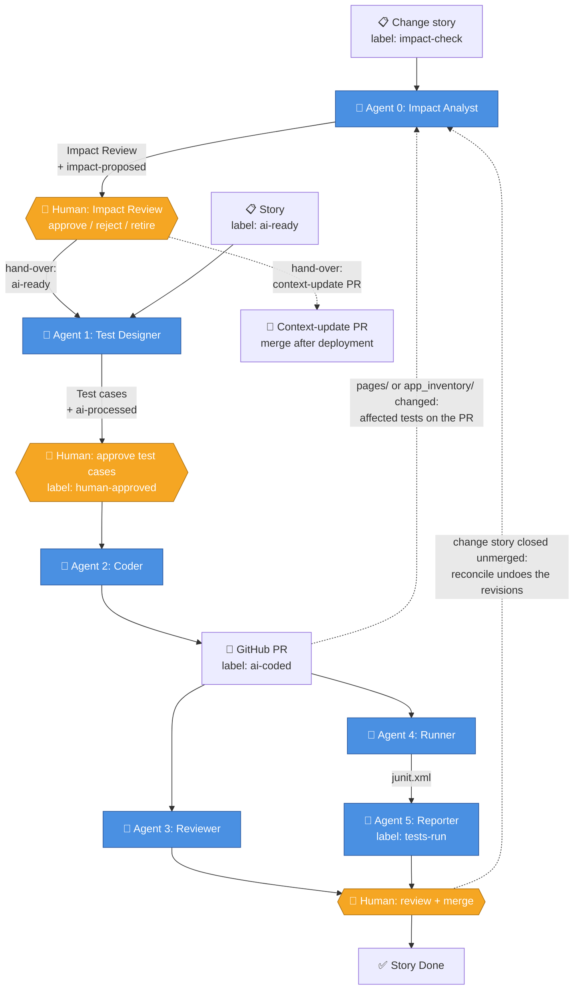
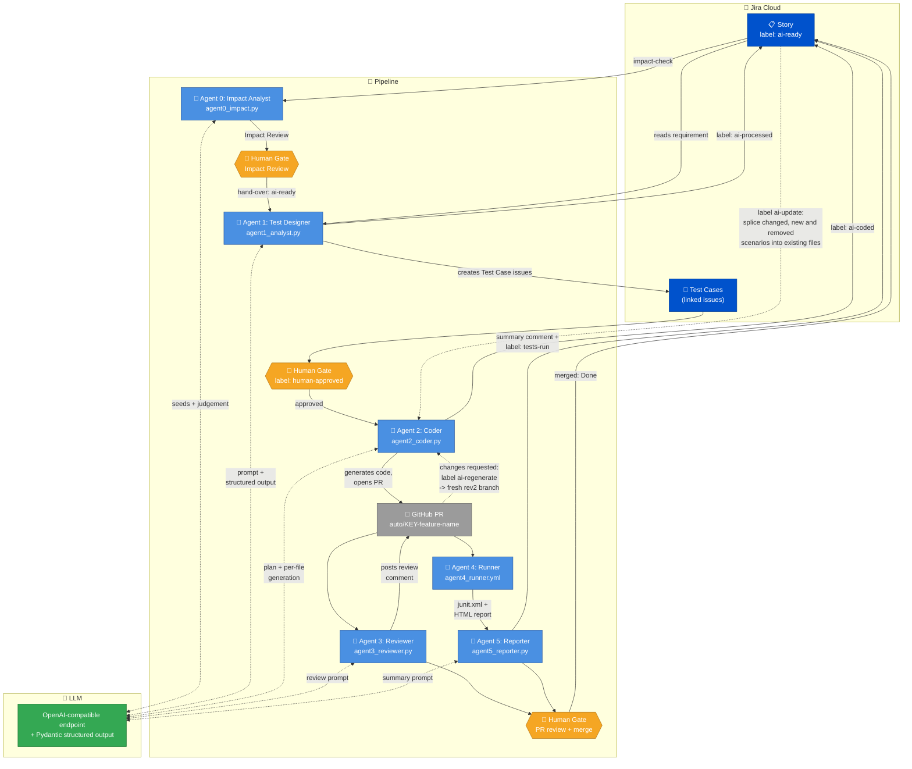
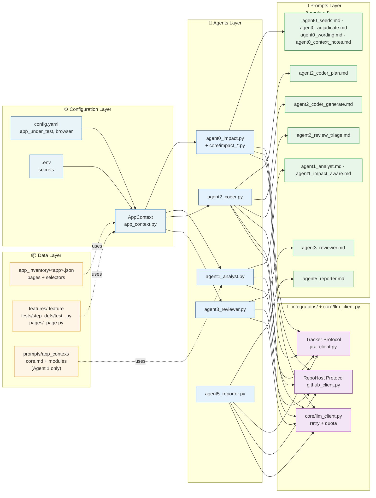
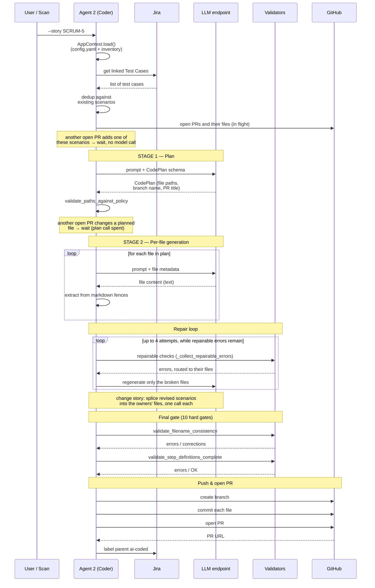
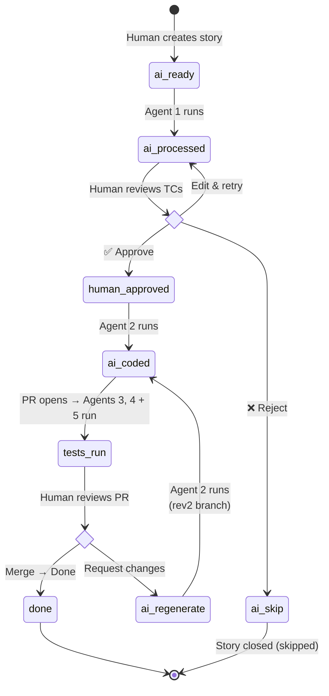

# 📖 Project Guide

Everything you need to operate, configure, extend, and onboard new apps to this framework — in one place.

## Table of Contents

1. [Architecture](#architecture)
2. [The six agents in depth](#the-six-agents-in-depth)
3. [The human-approval gate](#the-human-approval-gate)
4. [Change stories — Agent 0](#change-stories--agent-0)
5. [Making a change: which route to take](#making-a-change-which-route-to-take)
6. [Branch naming](#branch-naming)
7. [Configuration](#configuration)
8. [Running the pipeline](#running-the-pipeline)
9. [Inventory tooling — the full sequence](#inventory-tooling--the-full-sequence)
10. [The sweeper (stalled-PR backstop)](#the-sweeper-stalled-pr-backstop)
11. [Onboarding a new app](#onboarding-a-new-app)
12. [Diagram reference](#diagram-reference)
13. [Reading a test failure](#reading-a-test-failure)
14. [Troubleshooting](#troubleshooting)
15. [State management deep-dive](#state-management-deep-dive)

---

## Architecture



Agents 3 and 4 run on the pull request as soon as it opens — not after the
merge (Agent 4's browser run first waits its turn behind earlier PRs'). Agent 5 is a second job in Agent 4's workflow. Only a human merge moves
the story to Done.

For more diagrams — component view, Agent 2 sequence, and the labels-as-state-machine — see the "Architecture diagrams" section at the end of this guide.

### Key principles

- **No orchestrator.** Each agent runs in its own CI job, minutes or hours apart. All state lives in Jira labels, marker comments and the pull request — see [State management deep-dive](#state-management-deep-dive).
- **Model output is typed.** Every structured model reply is parsed through a Pydantic schema (22 of them, in `core/schemas.py`); a malformed reply gets one repair attempt, then fails.
- **Each agent stops at a checkpoint.** A human reviews before the next agent runs. See [the human-approval gate](#the-human-approval-gate).
- **Idempotency via Jira labels.** `ai-processed` (Agent 1 done), `ai-coded` (Agent 2 done), `tests-run` (Agent 5 done); for a change story `impact-proposed` (Agent 0 done, review open) and `impact-applied` (tests revised). Re-running an agent against an already-processed story is a no-op, and Agent 0 skips a story whose text it has already analysed.
- **Config-driven, not code-driven.** App-specific knowledge (URL, reference files, page inventory, module notes) lives in `config.yaml`, `app_inventory/` and `prompts/app_context/`. Agent code is app-agnostic.
- **Tools behind Protocols.** Agents talk to `Tracker` (23 operations) and `RepoHost` (20 operations) in `integrations/`, never to Jira or GitHub directly; the Jira and GitHub adapters are the only implementations today.
- **Defensive validators.** Between Agent 2's model output and the PR, 32 static checks run: the path policy on the plan, 10 hard gates in `_validate_generated_files()`, 27 validator calls in `_collect_repairable_errors()` (7 of them also hard gates), and the absence-claim check against the approved test cases (`_absence_claim_errors()`, in the repair loop and the final gate). Repairable failures feed a repair loop that regenerates only the broken files; the rest abort before a branch exists.

---

## The six agents in depth

| # | Agent | Implementation | Trigger | Model calls |
|:-:|---|---|---|---|
| 0 | Impact Analyst | `agents/agent0_impact.py` + `core/impact_*.py` | `impact-check` scan (weekdays 10:45 IST), PRs touching `pages/` or `app_inventory/`, nightly drift (or on demand, `mode` = `drift`) | 2 to analyse (more only past 300 candidates); up to 2 for the context update; 0 on code-change and drift runs |
| 1 | Test Designer | `agents/agent1_analyst.py`, `agents/agent1_impact.py` | cron, every 30 min, weekdays 10:00–19:00 IST | 1 (+1 if a rule fails) |
| 2 | Coder | `agents/agent2_coder.py`, `agents/agent2_impact.py` | cron, same window | 1 plan + 1 per file (+ repairs); a change story adds 1 per revised scenario and up to 1 per owner step file |
| 3 | Reviewer | `agents/agent3_reviewer.py` | PR opened / synchronize / reopened | 1 |
| 4 | Runner | `.github/workflows/agent4_runner.yml` | same PR events; a push to `main` touching framework paths | 0 |
| 5 | Reporter | `agents/agent5_reporter.py` (job 2 of Agent 4's workflow) | after Agent 4, on a PR whose browser tests ran | 1 |

Per story with no repairs: a **new story** takes 7 calls (1 draft, 1 plan, typically 3 files, 1 review, 1 report). A **change story** like A3 takes about 14–15: Agent 0 2 + 2 (context update), Agent 1 1, Agent 2 1 plan + typically 3 new files + 1 per revised scenario + 0–1 for the owner's step file, Agent 3 1 on the story PR + 1 on the context-update PR, Agent 5 1. Each push to an open PR runs Agents 3 and 5 again; a story that waits for another open PR spends its plan call again on the retry. Agent 5's end-to-end cost table is the measured figure (Agent 3's review of the context-update PR is not on it: that branch carries no story key).

Agent 0 is described in its own chapter, [Change stories — Agent 0](#change-stories--agent-0).

### Agent 1: Test Designer (`agents/agent1_analyst.py`)

**Role analogy:** QA test designer / QA Lead.

**What it does:**
1. Reads a Jira story (description + acceptance criteria) — manual mode (`--story KEY`) or scan mode (`--scan` reads selection criteria from config).
2. **Duplicate guard.** Refuses a story that already has linked Test Cases it owns, and says whether the last run finished or was interrupted (a partial set). The run turns red and a person decides. Test cases the story only *impacts* (Impacts links from Agent 0) do not count.
3. Calls the LLM with a prompt template (`prompts/agent1_analyst.md` + the `prompts/app_context/` modules, or a single `prompts/app_context.md`) and a Pydantic schema (`TestCaseList`). It drafts the FEWEST cases that cover the story, grouped by behaviour, not by input value.
4. Checks the draft against `core/test_case_rules.py` (each case runs on its own, no invented data) and `core/acceptance_coverage.py`: the acceptance criteria are read from the story text itself (numbered, bulleted or Given/When/Then lists under an "Acceptance criteria" heading, wiki markup or markdown) and numbered AC1, AC2, ...; the draft's coverage map must name, for every one, a test case of the draft that verifies it. A criterion that removes, replaces, renames, hides or no longer offers something needs a step whose expected result says it is absent and names it; one that restricts (only X can, Y cannot) a step showing the refusal; one that sets a limit or validation rule (at most N, required, a valid format) a step showing a violation rejected. A failing draft is sent back once with the problems listed; a second failure writes nothing.
5. Posts the coverage map on the story (`[agent1:coverage]`), so the reviewer sees which test verifies each criterion before adding `human-approved`.
6. For each test case, creates a "Test Case" issue in Jira linked to the parent story, carrying the story's Jira Components when it has some (a project that rejects them still gets the test case).
7. Tags the parent story with `ai-processed` (idempotency) and posts its token/cost ledger.

**Impact-aware mode (`agents/agent1_impact.py`).** When a story carries APPROVED impacted test cases (Impacts links made by Agent 0's hand-over), Agent 1 runs this mode instead: one `ImpactAwareDraft` call revises each approved case and adds new cases only for criteria its coverage map shows uncovered - the same coverage rule as above, where a revision counts only if it carries the step the criterion needs (a revised test that merely stopped using a removed field does not cover the removal), and an unchanged existing scenario may be cited for a criterion with no such obligation. The map is part of the gate comment. Before revising, it posts a snapshot of the old text on the test case (the undo source for reconcile); a revision that repeats an existing scenario is flagged in the gate comment. It labels the story `ai-processed` and `impact-applied`.

**Inputs:** Jira story key, or JQL-driven scan.
**Outputs:** Jira "Test Case" issues + `ai-processed` label on parent.

**Why this design:**
- Pydantic validation makes malformed LLM JSON fail loudly, not silently.
- Dry-run mode (`--dry-run`) lets you preview without writing to Jira — essential while iterating on prompts.
- The `prompts/app_context/` modules (or a single `prompts/app_context.md`) are the ONE place app-specific guidance lives. Agent 1 injects `core.md` plus the module(s) matching the story's Jira Component(s). A story with no components, or with only components that match no module, gets ALL modules - a longer prompt, but nothing lost. The risky case is partial: `Products` plus a misspelled `Cartt` loads `products.md` and silently drops `cart.md`. Agent 1 never reads the inventory, so everything it needs to draft correct test cases must be in these modules. Stories are written business-level - outcomes, not data - and `core.md` carries the table mapping phrases like "a product" or "several" to real values; Agent 1's prompt forbids inventing any. The main prompt template is app-agnostic.

### Agent 2: Coder (`agents/agent2_coder.py`)

**Role analogy:** SDET (Software Development Engineer in Test).

**What it does:**
1. Reads approved Test Cases from Jira (filtered by `ai-processed` AND `human-approved` labels).
2. Optional dedup check: if any test cases are already covered by existing scenarios, skip them — by marker first, then by title without the `[type]` tag. (`ai-regenerate` label bypasses this.) If another open PR already adds one of the scenarios, or (after the plan) changes a file this story would write, the story **waits** for the next scan instead — see *Two stories on one page object*.
3. **Stage 1 (Plan):** Calls the LLM with a Pydantic schema (`CodePlan`) — gets file paths, types, branch name, PR title. NO code yet.
4. **Stage 2 (Generate):** For EACH file in the plan, calls the LLM in text mode to generate the file's content.
5. **Validators:** 32 static checks run before a branch is created — see **The validator gate** below. Repairable failures go through the repair loop; anything still failing aborts the run.
6. Creates a branch (`auto/<JIRA-KEY>-<feature-name>`), commits files, opens a PR.
7. Tags the parent story with `ai-coded` (the card moves to In Review) and posts its cost.

**Review fix (`agents/agent2_review_fix.py`, `agent2_review_fix.yml`, ADR-017).**
A person with write access asks for a change on Agent 2's open pull request - a
**"Request changes" review** (its inline comments and text), or a comment
**`/fix <what to change>`** - every inline comment not handled yet, plus that
text (a bare `/fix` takes the inline comments alone). Bots never trigger it.
1. One structured call (`ReviewFixPlan`, `prompts/agent2_review_triage.md`)
   decides per comment: **fix**, **decline** or **no_change**. The approved test
   cases are the specification: a comment about how the code checks them is
   fixed; one asking to check something they do not state is declined with the
   way to get it - update the test case, then `ai-regenerate`.
2. Each named file is regenerated by Stage 2 in **review mode**
   (`generate_file_content(review_feedback=...)`): the current file, shown whole,
   plus the comments about it. Only the story's own files may change - those the
   pull request added, the feature files whose every `# JIRA:` marker is one of
   the story's test cases (an `ai-regenerate` or `ai-update` pull request
   modifies files that already existed) with their step definitions, and page
   objects it extends; a file holding another story's scenario, reserved and
   framework files never. A feature file must keep its
   scenarios, titles and markers; a degraded answer is discarded.
3. The repair loop and the final gate run over every code file of the pull
   request. Anything still failing, or a repair that reaches a file that is not
   editable: **nothing is pushed**, and the summary says why, listing each rule still broken.
4. Otherwise the files are pushed to the **same branch**, so Agents 3, 4 and 5
   run again; each comment gets a reply in its thread, the pull request one
   `[agent2:review-fix]` summary (which also stops a second run on the same
   review), and the story the cost as "Agent 2 (Coder, review fix)".
Settings: `agents.agent2_coder.review_fix` (`enabled`, `command`,
`branch_prefix`, `max_files` - 6 files per review).

**Two-stage approach (rationale):**
Asking the LLM for both structure AND large code bodies in one call has high failure rates — the model truncates, hallucinates, or returns malformed JSON. Splitting into a structured "plan" + per-file "text generation" is dramatically more reliable.

**Defensive features:**
- **Reserved paths guard.** Reads `app_under_test.reserved_paths` from config. If the LLM plans to overwrite a reserved file, the run aborts. Prevents the LLM from clobbering your reference test.
- **Branch-name validator.** Every branch must contain a Jira key (so Agent 5 can map back). Validated before pushing.
- **Filename consistency.** If the LLM generates `features/login-validation.feature` but writes `feature_path("login_validation")` (snake/kebab mismatch), Agent 2 auto-corrects (logs the fix) or fails loudly if the correction is ambiguous. See [DECISIONS.md → ADR-009](./DECISIONS.md) for details.
- **Step-def coverage.** Pairs each generated `.feature` with its `tests/step_defs/test_*.py` and verifies every Gherkin step has a matching `@given/@when/@then`. Hard-fails if any step is uncovered.

**How Agent 2 knows what methods exist (AST extraction):**

Nobody maintains a list of available helpers. Agent 2 reads them out of the
code with Python's `ast` module and injects the result into the generation
prompt, so **the prompt is partly generated from the source**. Rename a method
and the prompt updates itself on the next run.

Two extractions, both in `agent2_coder.py`:

| Extraction | What it produces |
|---|---|
| `_build_base_page_helpers_block()` | Parses `pages/base_page.py`, finds the `BasePage` class, and emits one line per public method: `self.<name>(<args>) -> <return>  # <first docstring line>`. `self` is stripped from the signature and `_`-prefixed helpers are skipped. |
| `_build_sibling_page_object_context()` | The same for page objects generated EARLIER IN THE SAME RUN, plus those already committed - `_existing_page_objects_on_main()` reads the story's own branch first, then main. Without it the model would write `click_logout()` in the page object and call `click_logout_link()` from the step definition minutes later — an AttributeError that only surfaces at test time. |

**Who receives what.** One template, three prompts - the same placeholders are
filled differently per file type, and `_sort_files_for_generation()` orders the
batch feature → page objects → step definitions so each extraction has
something real to read:

| File being generated | Receives |
|---|---|
| feature file | `_build_readable_values_block()` - what the inventory can actually show |
| page object | `_build_base_page_helpers_block()` + `_build_promised_values_block()` + sibling signatures |
| step definitions | `_build_sibling_page_object_context()` + `_build_authoritative_steps_block()` + `_build_reused_then_steps_block()` - real method signatures, the feature's exact step text, and the committed body of every Then step the feature reuses |

All of these are substituted ABOVE the cache marker, into the user message.

Why AST and not a regex over `def `: a regex cannot tell a method from a
function nested in another class, gets multi-line signatures wrong, has no idea
what a decorator does, and will happily match `def something()` written inside a
docstring. `ast.unparse(node.args)` gives the real signature; `ast.get_docstring`
gives the real docstring. Both extractions fail SOFT — an unparseable file
returns an empty block rather than aborting the run, because a missing helper
list degrades the prompt while a crash loses the whole story.

The validators lean on the same technique far more heavily.
`method_resolution_validator.py` walks generated step definitions for
`page.method(...)` calls and checks each against the methods that page object
actually defines, and walks page objects for `self.<method>(self.sel("key"))`
to enforce the `multi_match` rules. That is a structural check no amount of
string matching can do reliably.

**The repair loop:**

Validation failures are not immediately fatal. `_attempt_step_coverage_repair()`
collects every repairable error, groups them BY FILE, and re-generates only the
broken files - up to `max_retries` (4) attempts, one LLM call per broken file
per attempt. Each regeneration goes through `generate_file_content()` with the
errors as feedback; inside it, `_summarize_validator_feedback()` turns them into
targeted instructions.

Five guards matter:

- **Errors are routed to the file they belong to.** First
  `_route_to_generated_file()` makes every error name its generated file in the
  form `<rule> in '<file>':`, whatever wording the rule used (#193); then
  `_group_validator_errors_by_file()` groups them by that file. An error naming
  no generated file gets no targeted retry - it is not sent to every file,
  which would waste attempts rewriting correct code - but the final gate still
  reports it. If no error can be routed at all, repair is skipped.
- **No-progress stop.** If an attempt leaves the set of errors exactly as it
  was, the model is not converging and the loop stops, letting the final gate
  report it. Without this, a run once spent all four attempts on one unchanged
  error.
- **Non-convergence stop.** From the third attempt, if the error count has not
  fallen and the same RULES are still firing (`_rules_persisting()`), the loop
  stops and `_not_converging_hint()` says why. It compares rule names, not
  messages, because a stuck model rewords the step text while breaking the same
  rule. A rule that survives rewording nearly always means the test case asks
  for something the application cannot do.
- **Degraded-output stop.** A regeneration that comes back malformed for its
  own format, or dramatically smaller than before
  (`_is_degraded_regeneration()`), aborts the loop instead of compounding it;
  the final gate reports the prior attempt.
- **Infrastructure errors are never retried.** `QuotaExhaustedError` and
  `OutputTruncatedError` are re-raised, and `run()` does not catch them: the run
  stops and says why, rather than reporting non-convergence or committing half
  a file.

**Prompt caching:**

`prompts/agent2_coder_generate.md` carries a `CACHE BREAKPOINT` marker.
`generate_file_content()` splits the template there. Everything ABOVE it -
every substituted block: the BasePage helper list, sibling page-object
signatures, the reference files, the inventory, the test cases, repair
feedback - becomes the user message and is paid in full on every call.
Everything BELOW it is rule text with no substitutions: it is appended to the
system role, sent with `cache_control: ephemeral`, and read from cache on later
calls at roughly a tenth of the price. The split refuses to run if a
placeholder has leaked below the marker, since a variable value there would
change the prefix on every call and the cache would never hit. In a logged run,
14,872 of 39,655 input tokens came from cache: 37.5%. Adding a rule below the
marker is cheap after the first call; adding one above it is not.

Only one call site caches: `generate_file_content()` passes `cache_prefix`
when the template has static rules below the marker. Structured calls - Agents 1, 3 and 5, and
`build_plan()` - are not cached. `LLM_PROMPT_CACHE=0` switches caching off.

**Retries - all explicit:**

There is no automatic retry on an LLM call; `tenacity` is in
`requirements.txt` but nothing imports it. The retries that exist are
deliberate: a structured call gets ONE repair retry with the validation error
fed back (recorded as `structured-repair:<Schema>`), then raises `ValueError`;
the repair loop gets up to four attempts with the two aborts above; and a
scheduled agent whose run failed is picked up again on the next tick, because
its trigger label was never consumed.

**The validator gate:**

Thirty-two checks guard the generated batch: `validate_paths_against_policy`
on the plan, then the 10 hard gates below in `_validate_generated_files()`, run
in order, cheapest first, so an expensive AST walk only runs if the basic checks
pass. `_collect_repairable_errors()` makes 27 validator calls - the set the
repair loop uses, 7 of which are also hard gates - and `_absence_claim_errors()`
runs beside it wherever the approved test cases are known (the repair loop and
the final gate). Path policy + 10 + 27 − 7 + 1 = 32 distinct checks. The newest
three (`validators/absence_claims.py`) keep a removal verified all the way to the
browser: a test case's "is not shown" step stays in its scenario, a Then step
worded as absence asserts absence, and an absence predicate on a permanent
element (one the inventory does not list as `conditional`) proves its page is
loaded first - otherwise it also passes before the page has rendered.
`validate_reused_steps_keep_their_meaning` rejects a Then step that re-defines a
phrase another feature already defines but asserts more than that definition does. Every repairable error is routed to
the generated file it names, whatever its wording
(`_route_to_generated_file()`), so none reaches the final gate without a repair
attempt.

| # | Validator | Catches |
|---|---|---|
| 1 | `validate_filename_consistency` | A feature written as `login-validation.feature` but referenced as `feature_path("login_validation")` |
| 2 | `validate_feature_file_structure` | Malformed Gherkin — a Scenario with no Feature, a stray Background |
| 3 | `validate_extended_page_objects_keep_methods` | An extended page object that drops a method or changes a parameter list |
| 4 | `validate_step_definitions_complete` | A Gherkin step with no matching `@given/@when/@then` |
| 5 | `validate_no_duplicate_step_definitions` | The same step phrase defined twice in ONE file - the second silently shadows the first. Across files a repeat is safe: steps are module-scoped |
| 6 | `validate_imports_resolvable` | An import of a module or symbol that does not exist |
| 7 | `validate_method_resolution` | A step def calling `page.method()` that the page object never defines, or with arguments that do not fit its signature. Also protects tests already on `main`: a regenerated page object may not drop a method a committed step definition calls, nor change a signature so a committed call no longer binds - only breakage this batch caused is reported |
| 8 | `validate_page_object_selectors` | A literal selector in a page object, an invented inventory key, or a `multi_match` key used strictly |
| 9 | `validate_no_unused_step_definitions` | A step definition no scenario uses — usually two phrasings of one step |
| 10 | `validate_fixtures_exist` | A step def requesting a fixture no conftest provides |

Failures do not abort immediately: repairable ones go to the repair loop above,
and only what survives four attempts stops the run.

**Regeneration mode:**
Add label `ai-regenerate` to a parent story. Agent 2 will:
- Skip the dedup check
- Create a branch with `-rev2/-rev3/...` suffix
- Open a fresh PR
- Remove `ai-regenerate` after success (one-shot signal)
- The original PR stays open as historical record (close it manually)

**Change stories (`agents/agent2_impact.py`).** For a story with approved
impacted test cases, Agent 2 also splices each REVISED scenario into the file
that owns it (another story's feature and step definitions) and removes a
retired one, leaving every other scenario byte-identical; step functions the
change left unused are commented out. The splice writers
get the same grounding as the full-file writers — what the application can
show, and the real page-object method signatures — and a spliced step that
calls an unknown method is corrected once, with the validator's words, before
the final gate. `tests/unit/test_splice_grounding.py` fails if a new model
writer is added without grounding. An orphan cleanup that changed a file is
committed with the PR even when no step was added. The owners' feature and
step-definition files are never generated whole: `drop_owner_files()` removes
them from the plan and the path policy rejects them (one shared definition,
`protected_paths()`). Model calls: 1 per revised scenario, plus at most 1 per
owner step file for step functions it is missing (0 when the existing ones
already cover the revision).

### Agent 3: Reviewer (`agents/agent3_reviewer.py`)

**Role analogy:** Senior Engineer doing code review.

**What it does:**
1. Reads PR metadata + changed files through the repo host. The workflow checks out the BASE branch, so every PR is reviewed by the reviewer code, prompt and reference files on `main` — never by a stale copy on an old story branch.
2. Calls the LLM with a rigorous review prompt (`prompts/agent3_reviewer.md`) plus the reference files for style baseline, returning a `ReviewReport`.
3. Post-processes the response (`postprocess_review()`): deduplicates issues and caps at 10, withdraws unsubstantiated findings, lowers findings on lines this PR did not change to advice, and derives the verdict. **Blocking needs a named failure scenario**; when the only blocker is a predicted test failure, it waits up to 8 minutes for Agent 4's result on the same commit, and a green run refutes the block; a red run refutes each prediction whose own scenario passed on that commit (`runner_evidence_for_head()` reads the run's `junit.xml` from its `pytest-report-<run id>` artifact; the finding names its `scenario`, or quotes it in its failure scenario). A finding naming no scenario, a scenario not in the report, or a report that cannot be read is judged on the whole run, as before. All of this only when the PR changes a file read at test runtime (`core/test_runtime.py`); a unit-only green run proves nothing about a test failure. The prompt also lists every BasePage helper the changed page objects call, with its docstring (`base_page_helpers_called()`), and a finding about a helper's behaviour must agree with it.
4. Posts a markdown comment on the PR. Agent 3 never merges; its check goes red only for a finding that names a failure.

**Triggers:**
- Local: `python -m agents.agent3_reviewer --pr <N>`
- CI: `.github/workflows/agent3-reviewer.yml` runs on PR open/synchronize/reopen

**Why post-process instead of constraining the schema?**
Pydantic's `max_length=10` translates to JSON Schema `maxItems`, which some providers' constrained-decoding engines cannot compile on complex object arrays (it errors with "too many states for serving"). So we let the LLM produce an unbounded list and trim it deterministically in Python after.

**Anti-hallucination guardrails (built into the prompt):**
- Every issue must quote a specific line from the diff
- "When unsure, approve" — false positives erode trust
- Never speculate about caller behavior you can't see in the diff
- Never flag exception-raising as a bug unless the caller is in the diff and fails to handle it

### Agent 4: Runner

**Implementation:** `.github/workflows/agent4_runner.yml` (no Python module).

**Why no `.py` file?** Agent 4's job is "run pytest, parse junit.xml, upload artifacts." Zero LLM calls, zero API decisions. Wrapping shell commands in Python would be needless indirection. The workflow file is Agent 4 — full stop.

**What the workflow does:**
1. Checks out the PR branch
2. Installs Python deps and Playwright (with browser caching for speed)
3. Runs `pytest` — the offline unit suite and the BDD tests — with JUnit XML, HTML and Allure output; a failed test keeps its screenshot, video and Playwright trace. A BDD test whose failure names a temporary HTTP error from the application (5xx or 429) is re-run up to twice, 20 s apart (`pytest-rerunfailures`, `--only-rerun`); a failure in a test whose own request the server refused that way, and never answered afterwards, is restated to name it (`tests/conftest.py`), so it is re-run too; nothing else is re-run, and `scripts/collapse_junit_reruns.py` then keeps only each test's final attempt in `junit.xml`, so Agent 5's counts and Agent 3's per-scenario evidence see one result per test. Page loads are retried earlier still, inside `BasePage.navigate()`. On a pull request that changes only `prompts/`, `docs/` or Markdown the browser run and Agent 5 are skipped (see *What runs, per event*); on a push to `main` the browser runs only when a runtime file changed
4. On a pull request, before the browser run: waits while a run of another PR that started earlier has not finished (first come, first served, `scripts/e2e_turn.py`). Every PR tests the same live application with the same accounts, and saved state such as a cart would otherwise leak between them. Capped at 15 minutes, then it runs anyway; if the runs cannot be read it does not wait.
5. Uploads `reports/` as a workflow artifact (so Agent 5 can read it in the next job)
6. Writes a markdown test summary to the GitHub Actions job summary page

**Triggers:** PR opened, synchronized (new commits), reopened; a push to `main` touching framework paths; manual `workflow_dispatch`.

**Why combined with Agent 5 in one workflow?** GitHub Actions has a quirk: workflows triggered by `workflow_run` (cross-workflow) don't appear as PR checks. Combining Agent 4 + Agent 5 into one workflow with two jobs gives both visibility on the PR. Trade-off: Agent 5's check shows as "Agent 4 - Runner / Post Results to Jira" instead of "Agent 5 - Reporter / Post Results to Jira" — cosmetic only.

### Agent 5: Reporter (`agents/agent5_reporter.py`)

**Role analogy:** QA Lead writing a test results summary.

**What it does:**
1. Parses `reports/junit.xml` (produced by Agent 4) into a `RunReport`.
2. Scopes it to the story: keeps only the step-def modules the PR added or changed, so another story's failure is not counted as this one's. If the scope cannot be established it reports everything - over-reporting is cosmetic, hiding a story's own failure is not.
3. Keeps what scoping dropped. Agent 4 runs the whole suite, so a failure in a test the story does not own still turns the PR check red. Those failures are listed by Python in their own section, under a warning at the top of the comment, and the verdict is `failed` - it is `passed` only when the story's tests and everything else on the branch pass, so the comment always agrees with the PR check.
4. Enriches with CI context: PR URL, workflow run URL, commit SHA, link to artifact download.
5. Calls the LLM with a structured schema (`JiraCommentDraft`) to produce ONLY the prose summary of the story's own tests (Python adds the outside failures and the deterministic links after).
6. Posts the comment to the parent Jira story (resolved from PR branch name), with the end-to-end cost table. It runs only on a pull request whose browser tests ran: a PR changing only prompts, docs or Markdown gets no report.
7. Tags the story with `tests-run`.
8. **Change stories:** posts a one-line run result on each story that owns a revised test (`core/impact_results.py`) and records how Agent 0's prediction compared with what actually changed and failed — the measure used to judge Agent 0 in shadow mode.

**Why Python builds the deterministic parts:**
LLMs are bad at conditional rendering (`if PR_URL exists, include link`). Even with explicit instructions, they include "View PR (None)" or similar when fields are unavailable. Splitting prose (LLM) from facts (Python) eliminates this entire class of bugs.

**Story key resolution priority:**
1. `--story` CLI arg (explicit)
2. `JIRA_STORY_KEY` env var
3. Parsed from PR branch name (any `PROJ-123` pattern, regardless of prefix)
4. Skip cleanly (exit 0) if no key found — non-AI PRs don't get reports

---

## The human-approval gate

The architectural answer to "AI is fast but imperfect — how do we keep humans in control of cost and quality without slowing the system to a crawl?"

### End-to-end flow

```
[1] Parent Story (e.g., SCRUM-5 "Login functionality")
       label: ai-ready
              ↓
[2] Agent 1 reads it (business-hours cron)
       - Drafts the fewest test cases that cover the story (typically 3–7)
       - Creates linked Jira "Test Case" issues
       - Marks parent story:  label: ai-processed
              ↓
[3] HUMAN REVIEW  ← THE GATE
       - You open the parent story on Jira
       - Read each linked Test Case issue
       - Approve, edit descriptions, or reject (label: ai-skip)
       - When happy:        label: human-approved   (one click)
              ↓
[4] Agent 2's business-hours cron picks it up
       (OR you click "Run workflow" on `Agent 2 - Coder`)
              ↓
[5] Agent 2 runs (in CI)
       - Selects: stories with ai-processed AND human-approved
                  AND NOT ai-coded AND NOT ai-skip
       - For each: reads linked Test Cases → generates Playwright code
       - Opens PR
       - Marks parent story:  label: ai-coded
              ↓
[6] Agents 3 (Reviewer) + 4 (Runner) + 5 (Reporter) run on the PR
       (pull_request events; the hourly sweeper re-fires a stalled PR)
              ↓
[7] HUMAN REVIEW + MERGE  ← THE SECOND GATE
       - Only a merge moves the story to Done
```

A **change story** has a third gate before all of this: the Impact Review,
where a person decides each test Agent 0 found. See
[Change stories — Agent 0](#change-stories--agent-0).

### Why a gate at all?

Test cases are where the most expensive bad decisions happen. A bad test case → wasted LLM tokens on Agent 2 → broken PR → engineer time debugging. Cost of catching a bad test case BEFORE Agent 2 runs: 1 minute of human review. Cost AFTER: ~30 minutes of code review + cleanup.

The gate is between Agents 1 and 2 specifically because that's the highest-leverage checkpoint. Catching errors earlier is cheaper than catching them later.

### Label semantics

| Label | Meaning | Set by |
|---|---|---|
| `ai-ready` | "Process this story with Agent 1" | Human |
| `ai-processed` | "Agent 1 finished, Test Cases created" | Agent 1 |
| `human-approved` | "I reviewed the Test Cases and approve" | Human |
| `ai-skip` | "Don't process this story (override)" | Human |
| `ai-coded` | "Agent 2 finished, PR is open" | Agent 2 |
| `ai-regenerate` | "Regenerate code for this story — full rewrite (one-shot)" | Human |
| `ai-update` | "Surgically update code for changed/added/deleted Test Cases (one-shot)" | Human |
| `tests-run` | "Agent 5 posted test results" | Agent 5 |
| `impact-check` | "Analyse this change story with Agent 0" | Human |
| `impact-proposed` | "An Impact Review is open; a person decides" | Agent 0 |
| `impact-applied` | "Approved tests were revised; waiting for the PR to merge or close" | Agent 1 (impact-aware) |
| `impact-reverted` | "The PR closed unmerged; the revisions were undone" | Agent 0 reconcile |
| `ai-retired` | (on a Test Case) "Retired by a change; not run" | Agent 0 hand-over / reconcile |
| `inventory-drift` | (on the drift maintenance story) "Selectors stopped matching; these tests are affected" | Agent 0 drift job |

For the full lifecycle view (sticky vs one-shot semantics, who removes what),
see the "Label semantics table" in the State management deep-dive below.

---

### Only a merge marks the story Done

Every other board move is made by an agent that just did work. Done is
different: it means a person read the code and accepted it, which no agent can
know. `.github/workflows/story_done_on_merge.yml` fires on `pull_request:
closed` and is gated on `merged == true` - a PR closed without merging moves
nothing - then runs `scripts/close_merged_story.py`, which moves the story to
Done. A card in Done therefore always means a human merged the work.

### The board follows the work

`status_workflow` in `config.yaml` moves the card when a label is added
(`core/board_status.py`):

| Label | Column |
|---|---|
| `ai-processed` | In Progress |
| `ai-coded` | In Review |
| `impact-reverted` | To Do (an undone change story, ready to retry) |
| PR merged (`on_merge`) | Done |

Column names are configuration because they differ per board. A transition the
board does not allow is logged and ignored — a board move never fails a run
that has already done real work. A PR closed WITHOUT merging is a rejection: the
card stays in review, unless reconcile undoes a change story.

## Change stories — Agent 0

A **change story** alters behaviour that existing tests rely on. Revising those
tests by hand means finding them first, which is where coverage silently rots.
Agent 0 (`agents/agent0_impact.py`) finds them, ranks them with evidence, and
hands a person the decision.

### Modes

`agents.agent0_impact` in `config.yaml`, merged over the defaults in
`core/impact_settings.py`:

| Mode | Settings | Effect |
|---|---|---|
| off | `enabled: false` (framework default) | Every analysis job is skipped |
| shadow | `enabled: true`, `shadow_mode: true` | A report comment only; the label is removed and none added. Agent 5 still scores the prediction — the safe way to measure Agent 0 before it writes anything |
| live | `enabled: true`, `shadow_mode: false` | The report plus an Impact Review sub-task; `impact-check` → `impact-proposed` |

### Triggers (`.github/workflows/agent0_impact.yml`)

| Trigger | When | Model? | Output |
|---|---|---|---|
| Story scan | stories labelled `impact-check`; weekdays 10:45 IST or dispatch (optionally one `story_key`) | 2 calls (+1 per batch past 300 candidates); up to 2 more for the context update | report, or Impact Review. A full scan (`story_key` blank) also hands over decided reviews; a one-story run does not |
| Code change | any PR touching `pages/**` or `app_inventory/**` | none | methods and selectors changed or removed → the affected tests, posted on the PR |
| Nightly drift | 07:15 IST, after the inventory staleness check, or dispatch with `mode` = `drift` | none | a selector that stopped matching → the affected tests; live mode opens one maintenance story; then the inventory-update PR (below) |
| Reconcile | its own job: weekdays 10:45 IST and every manual run in `scan` mode, whatever the Agent 0 mode (off, shadow, live) | none | settles stories labelled `impact-applied` |

### How a story is analysed (`core/impact_analysis.py`)

1. **Repeat check** — a story whose text hash has not changed since the last analysis is skipped. A re-analysis after an edit updates the report in place and says whether anything changed.
2. **Seeds** — one `ChangeSeeds` call classifies the change (`change_type`) and names the inventory elements, behaviours and components it changes (`prompts/agent0_seeds.md`). An element key that is not in the inventory is dropped and reported. A story classified `new_behaviour` keeps no seeds at all: using a behaviour is not changing it (#186).
3. **Candidates** — the impact graph (`core/impact_graph.py`: scenario → step → method → selector, built from `# JIRA:` markers and the code) gives structural candidates (layer 1); the story's Component, or the whole suite when it has none, gives the rest (layer 2), ordered by word overlap with the story. At most `max_candidates` (300) are judged: layer 1 always, layer 2 fills the remaining places, and the others are listed as *not judged*, never as unaffected. Owners and open PRs are attached (the in-flight guard).
4. **Judgement** — one `ImpactAssessment` call judges each candidate with evidence (`prompts/agent0_adjudicate.md`); a second call is needed only when layer 1 alone exceeds 300. A verdict that cites no real graph path or verbatim step is dropped.
5. **Rank** — a weighted score (structural 0.45, component 0.15, semantic 0.15, adjudicated 0.25) sets the tier: **must-update ≥ 0.6, review ≥ 0.3**, otherwise unaffected. The model's verdict is the ceiling: structure alone never promotes a test the model judged *review* or *unaffected*. Each row shows a short reason and the elements involved.
6. **Publish** — shadow: a report. Live: nothing to review → `ai-ready` (and the context update); otherwise an Impact Review sub-task (`core/impact_review.py`) and `impact-proposed`.

### The Impact Review and the hand-over

The Impact Review is one sub-task under the change story with a table of the
affected tests and a Decision column: **approve** (revise it), **reject** (leave
it) or **retire** (it no longer applies). The data behind the table is stored in
a JSON code block; `core/json_block.py` reads it back in every format Jira
writes after a person edits it. An unreadable or empty review refuses to hand
over.

When the sub-task is Done, the next scan hands over (`core/impact_handover.py`):

- **Impacts** links from the change story to each approved or retired test and to its owning story
- `ai-retired` on retired tests
- a *will-revise* trace comment on each owning story (`core/impact_trace.py`)
- `impact-check` / `impact-proposed` off, `ai-ready` on — Agent 1 then runs in impact-aware mode
- the **context update** (below)

### Context update (`core/context_update.py`)

Agents 1 and 2 read reference material that agents only propose changes to,
through pull requests a person merges: the inventory (every selector and its
notes) and `prompts/app_context/`. Two proposals exist - the nightly
inventory update (next section) for what the live application shows, and this
one for what a change story changes. A change story makes the material
stale. At hand-over Agent 0 proposes the update as a pull request:

- **Wording** the story replaces (a label, a message) — one model call lists old → new (`prompts/agent0_wording.md`); the replacement is applied exactly to the inventory's values and the notes. A change whose old text appears nowhere is dropped and reported.
- **Passages the story makes untrue** — behaviour, rules, removed elements. One more call rewrites each such passage (`prompts/agent0_context_notes.md`). A passage not found verbatim is dropped and reported. **A rewrite never touches a selector**: the element is live until the change is deployed. (A *wording* change, above, does update a selector that matches on the old text - which is why the PR waits for deployment.)
- Code mentioning the old text is listed, not edited — code changes go through the story's own PR.

The branch is `context-update/<story key in lower case>`, which no tool reads as
an issue key, so merging it neither closes the story nor reports on it. **Merge it after the change is
deployed**; the nightly inventory check then confirms the selectors. No PR is
opened when nothing is stale. A story can therefore have two PRs: its own code
PR (every approved impact, of any kind) and the context-update PR (reference
material only).

### Inventory update — the nightly pull request (`core/inventory_update.py`)

After the drift analysis, the drift job turns the crawl's report into **one
pull request at a time**, on a dated branch `inventory-update/<date>`
(`scripts/propose_inventory_update.py`; settings
`agents.agent0_impact.inventory_update`). Every rule errs toward leaving the
inventory alone:

| Found by the crawl | What the PR does |
|---|---|
| A stale key, and the crawl finds the element the generator names the same, with a durable selector | **Replaces** the selector; the key and every page object using it stay valid |
| A stale key no code names - no string literal under `code_dirs` on `main`, none added by an **open pull request** - not the row family | **Removes** it, with its note and its `multi_match` / `conditional` entries |
| A stale key code names (on `main` or in an open PR) | **Keeps** it and lists it: a page object needs a new selector, or a change story's absence test needs the key |
| A live element no selector covers | **Adds** it - the generator's own name and selector **and its declarations** (a family → `multi_match`, a hidden element → `conditional`), the proposals file's refusal rules, at most `max_additions_per_page` per page |
| An element the generator flags for review (a css fallback, an index-pinned `>> nth=` member, hidden when crawled) | Listed, **never added** |
| More than `hold_ratio` of a page's selectors stale | **Leaves the page alone** and lists it: an error page, an outage or a redesign is a person's call |
| Ambiguous selectors, unreachable pages, untracked test-ids | Listed only |

Merge it after checking the names and Agent 4's run on it - the suite runs
against the updated inventory, and Agent 0 lists the tests it touches. Nothing
is merged by an agent. The next night leaves an unchanged proposal alone,
**closes** one nobody edited (a comment, then `close_pull_request`; its branch
is deleted best-effort, since a repository may forbid deletion) and opens a
fresh one on a new dated branch when something is left to change. Once **you
commit to the branch** (a better key name, say), or for any PR on the prefix
without the bot's marker, it is never touched and no second proposal is
opened - it gets one comment per new finding instead.

Nothing is proposed and nothing closed when the crawl measured no page (login
failed, site down) or the report is older than `uncovered_max_age_hours`.
When the open pull requests cannot be read, **no key is removed** (a story in
flight may use it). In Agent 0's shadow mode, or with `--dry-run`, the PR body
is printed, not opened. Edits are selective, never a regeneration, so curated
notes and declarations stay; each table in the body shows at most 60 rows. The
manual route (`check_inventory_staleness --propose` → mark rows →
`apply_inventory_proposals`) still works for a one-off.

### Reconcile — finish or undo (`core/impact_reconcile.py`)

Every story labelled `impact-applied` is settled on each scan:

| PR state | Action |
|---|---|
| open | nothing |
| merged | a *merged* trace on each owner; `impact-applied` removed |
| closed unmerged, first scan | a `[agent0:reconcile] closed-unmerged` comment (a sweeper close-and-reopen is not mistaken for a rejection) |
| closed unmerged, same close seen on `closed_scans` scans (default 2: the next scan) | **undo**: each revised test whose text is still what the change wrote gets its snapshot back (one edited since is left for a person and named); tests are un-retired; Impacts links removed; a *restored* trace on each owner; `impact-reverted` |
| no PR after `no_pr_days` (14) | one comment asking a person to decide |

After an undo the story is left ready to retry or drop, not half-done: its own
test cases that never reached `main` are retired (reversible), the labels in
`reconcile.reset_labels` (`ai-processed`, `human-approved`, `ai-coded`,
`tests-run`) are removed, the Impact Review is renamed `[undone PR #N] Impact
Review: …` (so it no longer counts), the card moves to To Do, and one comment
says how to retry: remove `impact-reverted`, add `impact-check`.

**A retry is its own attempt.** Agent 0 analyses the story afresh and opens a
new Impact Review. Agent 1 writes `Change applied at: <UTC>` in its gate
comment whenever it revises or creates tests, and reconcile considers only PRs
opened after that, so the earlier attempt's closed (or merged) PR can never
undo (or finish) the retry. The context update is checked again too: its
marker counts only for the story text it carries (`(story: <hash>)`) and only
after the latest undo.

Reconcile keeps its memory in marker comments, so it can run anywhere, any
number of times.

### Onboarding Agent 0 to another application

See [AGENT0_ONBOARDING.md](./AGENT0_ONBOARDING.md). `python -m scripts.onboarding_check`
reports whether an application is ready (layout, inventory components,
scenario markers, adapters); `python -m scripts.backfill_markers` gives unmarked
scenarios their `# JIRA:` marker; `python -m scripts.agent0_backtest` measures
Agent 0 against the repository's own history.

## Making a change: which route to take

Most changes in this repo are made by Agent 2, not by you, and those need
nothing from this section — the agent creates its own branch and opens its own
PR. This is about the changes a **human** makes: to the framework, or to test
code the agent already wrote.

The question is never "should I be disciplined and use a PR". It is: **does
anything actually execute this code before it reaches `main`?** For some
directories the answer is yes and pushing is safe. For others the answer is no,
and a PR is the only thing that runs them.

### The decision, in one table

| You changed | Route | Why |
|---|---|---|
| `agents/`, `core/`, `validators/`, `integrations/`, `inventory_tools/`, `scripts/`, `config/`, `prompts/`, `tests/unit/` | **Branch + PR** (a repository admin may push to `main` as a ruleset bypass) | The unit suite covers these. It runs on the PR, and on a push to `main`; a broken validator or a bad prompt template fails in about two minutes. |
| `app_inventory/` | **Branch + PR** (admin bypass possible, as above) | This one runs the unit suite **and** the E2E, because page objects read the inventory at runtime. A PR touching `pages/` or `app_inventory/` also gets Agent 0's code-change report. |
| `pages/`, `features/`, `tests/step_defs/` | **Branch + PR** | The E2E suite is SKIPPED on push. Nothing executes this code before it lands. |
| Both in one commit | **Branch + PR** | The stricter rule wins. |
| Agent 2's output, on a story that already has a PR | **That PR's existing branch** | It is already open; a commit re-runs Agents 3 and 4 on your fix. |
| A change you want on Agent 2's open PR, without editing it yourself | **Ask Agent 2**: a "Request changes" review, or `/fix <what to change>` | Agent 2 fixes it on the same branch through the same gate, and Agents 3, 4 and 5 re-run (Route 2b). |
| Anything generated by Agent 2, normally | **Nothing — it is automatic** | Agent 2 branches, pushes and opens the PR itself. |

### Route 1 — Agent-written code (the normal flow)

No manual branching, ever. Agent 2 creates `auto/<JIRA-KEY>-<feature>`, commits
the generated files, and opens a pull request. Agents 3 and 4 fire on that PR
automatically; Agent 5 posts results to Jira. You review and merge.

Nothing in this section applies unless you want to change what it produced.

### Route 2 — Editing Agent 2's code on the CURRENT story

You have reviewed the PR, most of it is right, one page object needs a fix.

**Do not create a branch, and do not re-run Agent 2.** The PR already exists.
Check out its branch and commit onto it:

```bash
git fetch
git checkout auto/SCRUM-42-search-products     # the branch on the open PR
# ...fix pages/products_page.py...
git commit -am "fix: correct the search selector"
git push
```

That push fires `pull_request: synchronize`, so **Agents 3 and 4 re-run on your
fix**, on the same PR, at no token cost. Merge when green.

> **Never create a branch of your own under `auto/`.** The sweeper filters
> workflow runs by `head_ref` starting with `auto/`, and Agent 5 parses the
> Jira key out of the branch name. A hand-made branch under that prefix will be
> mistaken for a story run. Use `fix/`, `chore/` or `framework/`.

### Route 2b — Asking Agent 2 to make the fix

Leave the review as you would for a person: inline comments on the lines, then
**Request changes** - or comment `/fix rename the step to match the test case`.
GitHub does not let a pull request's author request changes on it: when
`GH_PAT` is your own account, Agent 2's pull requests are yours, so leave the
inline comments with **Comment** and then post a bare `/fix`.
Agent 2 replies in each comment's thread, pushes what it fixed to the same
branch, and posts one `[agent2:review-fix]` summary listing every comment's
outcome. Nothing is pushed unless the whole pull request passes the validator
gate again. A comment that asks the tests to check something the approved test
cases do not state is declined: change the test case, then add `ai-regenerate`.

### Route 3 — Editing test code with no story PR open

Fixing a test from an already-merged story, or a page object several stories
depend on. There is no agent PR to commit to, so you make one:

```bash
git checkout -b fix/cart-row-selector
# ...edit pages/cart_page.py...
git commit -am "fix: cart rows are scoped to the table body"
git push -u origin fix/cart-row-selector
# open a PR on GitHub; Agents 3 and 4 run before you can merge
```

This route exists because of a specific gap: **a push to `main` never runs the
E2E suite.** Push a page-object fix straight to `main` and the browser steps are
skipped, so the change lands with nothing having executed it. You find out
during someone else's story run.

### Route 4 — Framework changes

`main` is protected by a ruleset that requires a pull request, so the normal
route is a `fix/` or `chore/` branch and a PR, exactly as in Route 3. A
repository admin can still push to `main` - GitHub records it as a bypass - and
the push gate below then runs after the fact:

```bash
# ...edit validators/, core/, app_inventory/, prompts/...
git commit -am "fix: scope the search selector to the filter panel"
git push
```

Agent 4 fires on push, runs the full unit suite in about two minutes, and skips
the browser unless a runtime file changed.

**What that costs, honestly:** the gate reports *after* the merge rather than
preventing it, and every agent workflow checks out `main` — so a broken change
is live for the next scheduled run. For framework code that trade is
acceptable: you know within a minute, and `git revert` is cheap. If you would
rather close even that window, nothing stops you using a branch; the same gate
runs on `pull_request`.

### Why the two routes differ

Consider a single commit touching `validators/method_resolution_validator.py`
**and** `pages/products_page.py`, pushed to `main`:

- the workflow fires — `validators/**` is a watched path
- the full unit suite runs and passes
- the browser is never installed, and `tests/step_defs/` is never executed

The validator change is genuinely verified. The page object is not. It reached
`main` with nothing having run it, and the first execution will be inside an
unrelated story's PR — which is exactly the "a framework break shows up as a
red check on someone else's story" problem that the push gate was added to fix
in the first place.

That is the whole reason app-layer code takes a different route. It is not
about ceremony; it is about which files the push gate actually exercises.

### What runs, per event

| # | Situation | Workflow runs? | Unit | E2E | Agent 5 → Jira |
|---|---|---|---|---|---|
| 1 | Push to `main`, **runtime file** changed | yes | ✅ | ✅ | — |
| 2 | Push to `main`, framework only (`prompts/`, `validators/`, `core/`) | yes | ✅ | — | — |
| 3 | Push to `main`, docs only | **no** | — | — | — |
| 4 | Push to any non-`main` branch | **no** | — | — | — |
| 5 | Pull request (opened, synchronize, reopened) | yes | ✅ | ✅ (after earlier PRs' browser runs) | ✅ |
| 5b | Pull request changing only `prompts/`, `docs/` or Markdown | yes | ✅ | — | — |
| 6 | Manual dispatch | yes | ✅ | ✅ | — |
| 7 | Push to `main`, **detector crashed** | yes | ✅ | ✅ | — |

Rows worth explaining:

- **Row 3** — `docs/` is not a watched path, so no run is created at all. Nothing
  validates prose, and running the suite on a typo fix would burn CI for nothing.
- **Row 4** — the push trigger is `branches: [main]`, so a branch push is silent
  until you open a PR, at which point row 5 applies and everything runs. Open the
  PR straight away (a draft is fine) and every later commit is covered by
  `synchronize`.
- **Row 5** — Agent 5 posts only here, because only a pull request belongs to a
  story.
- **Row 7 — the E2E FAILS OPEN.** The browser steps test
  `steps.changes.outputs.inventory != 'false'`, not `== 'true'`, so **only an
  explicit "no" skips them.** A crashed, skipped or empty output runs them. With
  the earlier `== 'true'`, a detector that died left the output empty, the
  browser silently skipped, and the job went green reporting "all unit tests
  passed" — an inventory change no browser had exercised, merged on a passing
  check. The detector also carries `continue-on-error: true`, so it can only
  ever downgrade the run, never fail it.

**The summary always says why.** A push that legitimately skips the browser
used to report "All N tests passed" with no mention of it, which invites the
reader to assume the app tests passed too. The job summary now carries one of:

These are the notes verbatim, so you can recognise them in a run.

**Row 1 — a runtime file changed:**

> ✅ A runtime-affecting file changed, so the app E2E ran as well as the unit
> suite.

**Row 2 — nothing runtime changed.** This is the common one, and the reason it
exists: without it the summary read "All 639 tests passed" and said nothing
about the browser, which invites the reader to assume the app tests were among
them.

> ℹ️ **App E2E not run.** No runtime-affecting file changed in this push, so
> only the unit suite ran. The browser runs when `app_inventory/`,
> `config/config.yaml`, `pages/base_page.py` or either `conftest.py` changes —
> those are read while a test runs, so editing them changes what the existing
> tests do.

So a push touching only `validators/`, `core/` or `prompts/` gets this note and
a green tick, and both are correct: those files are read when an AGENT runs, not
when a test runs, so a browser would spend three minutes proving nothing.

**Row 7 — the detector failed:**

> ⚠️ **The change detector failed**, so the app E2E was run anyway rather than
> skipped. Its result is above. Check the *Detect runtime-affecting changes*
> step for the error — a force-push is the usual cause, since the previous SHA
> is then unreachable.

**Defensive — no verdict at all:**

> ⚠️ **The change detector produced no verdict**, so the app E2E was run rather
> than skipped.

Only on a push. A manual dispatch always runs the E2E.

**A pull request** has its own check (*Detect whether this pull request can
change a test result*). It skips the browser only when every changed file is
one no test reads — `prompts/` (agent prompts and the app-context notes),
`docs/`, Markdown; the rule is `core/test_runtime.py`. The typical case is a
context-update PR that rewrites notes only: it used to go red on a live-site
flake it could not have caused. The unit suite still runs, the report job
(Agent 5) is skipped, and the summary says:

> ℹ️ **App E2E not run.** This pull request changes only prompts, docs or
> Markdown - nothing a test reads while it runs - so only the unit suite ran,
> and no result is posted to Jira. Any other file runs the browser.

Any other file, an unknown path, an API error or an empty file list runs the
E2E (fail open). Agent 3 uses the same rule: on such a PR a green Agent 4 run
is not taken as evidence against a predicted test failure.

A detector failure is most often a **force-push**: `github.event.before` then
points at a commit that no longer exists, and `git diff` cannot resolve it.

**Which pushes run the E2E.** The test doesn't decide by folder — it asks
whether the file is **read while a test runs**. Change one of these and every
existing E2E test behaves differently, with no code change at all:

| File | Read at runtime by |
|---|---|
| `app_inventory/**` | `BasePage.sel()` resolves every selector here |
| `config/config.yaml` | `base_url`, `browser.timeout`, `headless` |
| `pages/base_page.py` | every page object inherits it |
| `tests/conftest.py` | the browser and the failure-evidence capture |
| `tests/step_defs/conftest.py` | every page-object fixture and the credential resolver |

**What does NOT run it,** despite being framework code: `prompts/**` and
`core/app_context.py`. Both are inputs to the AGENTS — they shape what gets
generated the next time an agent runs, and cannot alter code that already
exists. A browser run would spend three minutes proving nothing. They still get
the unit suite, which catches a deleted placeholder or a broken template.

The distinction is worth stating plainly, because "framework input" and
"runtime dependency" are not the same set. Neither conftest is an agent input,
yet together they ARE the E2E runtime; `core/app_context.py` is an agent input
that no test ever loads.

`tests/step_defs/**` is deliberately not watched as a whole — that directory
also holds Agent 2's generated step definitions, and including it would re-fire
this gate whenever a story PR merges, on files Agent 4 has already tested.

Two things worth knowing:

- **A manual dispatch runs everything except the Jira post.** That is the way
  to run the full suite against `main` without opening a PR — no story gets a
  spurious comment, because a manual run is not tied to one.
- **Agent 5 is skipped on push and on dispatch by design.** Its job is to
  report a story's result, and neither of those events belongs to a story.

### Two stories on one page object

Agent 2 reads the page objects that already exist before it writes, so a story
reusing an earlier story's page object sees its real method names rather than
inventing new ones. It reads the story's OWN branch first, falling back to
`main` — a re-run, or an `ai-update` on a story already coded, therefore sees
the methods that run wrote instead of renaming its own work.

It does not read ANOTHER story's open branch, and does not need to: Agent 2
never writes a file another open pull request is changing (`core/in_flight.py`).
Two stories both branch from `main` and Agent 2 writes whole files, so if both
rewrote one page object the second merge would conflict, or silently drop the
first one's methods. Instead the second story **waits**:

- before the plan: if another open PR already adds a scenario with the same
  title as one of this story's test cases (compared without the `[type]` tag),
  the story waits — no model call is spent;
- after the plan: if any file the plan writes (feature, step definitions, page
  object, an owner's file for a change story) is changed by another open PR,
  the story waits — only the plan call is spent, and it is recorded on the
  story's cost ledger as `Agent 2 (Coder, waiting)`;
- `ai-update` checks its feature file and step definitions before any model
  call, and any page object its orphan cleanup would edit.

Waiting means: nothing is generated or committed, labels are unchanged, and one
comment on the story says which PR and which file or scenario
(`[agent2:waiting] …`, posted once per reason, not on every scan). The scan
summary shows `[WAIT]`, not `[FAIL]`. The next scan retries; once the other PR
merges, `main` holds its work and the story extends it (or skips the duplicate
scenario); once it is closed unmerged, nothing stands in the way. If the open
PRs cannot be read, the story proceeds as before (fail open). Your own story's
earlier PRs, and its context-update PR, never make it wait.

What still guards a page object:

| | |
|---|---|
| **In-flight wait** | Two open PRs never write the same file. |
| **Branch-aware read** | Handles the common case — the same story generated more than once. |
| **`validate_no_duplicate_page_object_methods`** | Fails the gate when one page object gains two methods meaning the same thing, comparing names by their meaning-bearing words so word order and filler do not hide it. |

The validator is deliberately narrow: `get_quantity` and `set_quantity` are an
accessor and a mutator, not a duplicate, so `get` and `set` are not treated as
filler. A false positive here would cost a repair attempt on correct code.

### Fix the branch, or fix the inventory?

A one-off correction belongs on the story's branch (Route 2). A *systemic* one
— the generator would make the same mistake on the next story — belongs in
`app_inventory/` or `prompts/`:

1. fix the inventory note or the prompt rule
2. merge it to `main` (Route 4)
3. add `ai-regenerate` to the story and dispatch Agent 2

Agent 2 branches fresh as `…-rev2` and leaves the old PR intact as a record.

Editing a branch by hand fixes one story. Fixing the inventory fixes every
story after it.

### What each check can and cannot prove

| Check | Trigger | Proves | Cannot prove |
|---|---|---|---|
| Unit suite (`agent4_runner.yml`) | push, PR, dispatch | Framework logic; the inventory is structurally sound — every `sel()` key exists, every declared family is real | That a selector resolves |
| App E2E (`agent4_runner.yml`) | PR (unless it changes only prompts, docs or Markdown), push to `main` touching a runtime file, dispatch | The application behaves as the story says | Whether other pages have drifted |
| `Inventory Health` (`inventory_health.yml`) | nightly, dispatch | Selectors actually RESOLVE against the live application | Whether behaviour is correct |

The middle row has no equivalent in ordinary software. A compiler proves your
code is internally consistent; it cannot prove that a selector still matches a
site someone else deploys. Every expensive failure so far lived in that gap — a
row index pointing at a checkbox column, an autocomplete whose first row is a
loading placeholder, a link whose accessible name was polluted by icon ligature
text. None would have failed to compile. All three took seconds to find with a
browser.

### Changes worth a local run first

Anything touching `app_inventory/` or `prompts/` is best proved locally before
it reaches CI at all — those are the changes the unit suite is weakest at:

```bash
python -m scripts.verify_locators --only-problems   # do the selectors resolve?
pytest tests/step_defs/ --headed -v                 # does the reference test pass?
```

Minutes and no tokens, against ten minutes and roughly a dollar for an agent
run that fails on the same thing.

### Branch protection

`main` is protected by a repository ruleset: changes arrive through a pull
request, and force-pushes and deletion are blocked. Repository admins are on the
bypass list, so the agents - which push with the owner's `GH_PAT` - and an admin
can still create branches and, if needed, push directly; GitHub records each
bypass. A second ruleset on every branch restricts creating, updating and
deleting branches to the bypass list as well, so a collaborator who is not on it
cannot push a branch at all - widen it before adding one.

No status check is required yet. Requiring `Agent 4 - Runner / Run Tests` would
turn the gate from a report into a block; do it only once the pipeline is
reliably green, and remember that a change story's PR is expected to fail its
E2E until the change is deployed.

## Branch naming

Agent 2 generates branches in the form:

```
auto/<JIRA-KEY>-<feature-name>
```

Examples:
- `auto/SCRUM-5-login-validation`
- `auto/PROJ-123-cart-checkout`

### Why this convention

The Jira key in the branch name is **load-bearing**: Agent 5 extracts it via regex to know which Jira story to post results to. Without a key, Agent 5 can't close the loop — so it skips (gracefully, not as an error).

The regex is in `config/__init__.py`:
```python
JIRA_KEY_PATTERN = re.compile(r"\b([A-Z][A-Z0-9_]*-\d+)\b")
```

Works for any project prefix: `SCRUM-1`, `PROJ-123`, `MOBILE-42`, `BACKEND-5678`, etc.

### What the validator enforces

`config.assert_valid_branch_for_pipeline(branch_name)` raises `InvalidBranchNameError` if no key is found. Agent 2 calls this before pushing — better to fail BEFORE creating a branch than to discover the gap downstream.

For ad-hoc human branches without a key (e.g., `feature/foo`): Agent 5 detects the missing key, logs a warning, and exits 0. The PR still gets normal CI but no Jira comment.

---

## Configuration

### Environment variables (`.env`)

| Variable | Required | Used by | Notes |
|---|---|---|---|
| `JIRA_URL` | yes | All Jira-touching agents | e.g., `https://yoursite.atlassian.net` |
| `JIRA_EMAIL` | yes | Same | Your Jira account email |
| `JIRA_API_TOKEN` | yes | Same | Create at id.atlassian.com → Security → API tokens |
| `JIRA_PROJECT_KEY` | yes | Same | e.g., `SCRUM`, `PROJ` |
| `JIRA_BOARD_ID` | no* | Agents 1, 2 (scan) | Numeric board ID. *Required only when config.yaml uses `sprint: "auto"`. Find it in the board URL: `.../boards/<ID>` |
| `LLM_PRICE_INPUT_PER_1M` | no | All LLM agents | USD per 1M **input** tokens (repo **Variable**, not secret — e.g. `3.00`). Enables real cost numbers in logs and the story cost ledger. Unset → tokens still logged, cost shows "n/a". |
| `LLM_PRICE_OUTPUT_PER_1M` | no | All LLM agents | USD per 1M **output** tokens (e.g. `15.00`). Set both or neither. |
| `OPENAI_API_KEY` | yes | All agents (LLM) | Your LLM provider's API key |
| `OPENAI_API_BASE` | yes | Same | Base URL of your OpenAI-compatible API endpoint |
| `LLM_MODEL` | no | Same | Model name sent to the endpoint. Set it explicitly; the code's fallback is only a placeholder |
| `GITHUB_TOKEN` | yes | Agents 0, 2, 3, 5 and the sweeper | PAT with `repo` scope (CI passes `GH_PAT` for Agents 0 and 2 - its review fix included - and the sweeper, so the PRs they open and the fixes they push trigger workflows) |
| `REVIEW_FIX_TEXT` | no | Agent 2 review fix | The review's or `/fix` comment's text; the workflow passes the event's text here, never on a command line |
| `GITHUB_REPO` | yes | Same | `<owner>/<repo>` format |
| `BASE_URL` | no | Tests at runtime | Override `config.yaml`'s base_url |
| `PLAYWRIGHT_HEADLESS` | no | conftest | `true`/`false` — overrides config.yaml |
| `JIRA_STORY_KEY` | no | Agent 5 | Manual override for story resolution |
| `PR_NUMBER` | no | Agents 3, 5 | Manual override for PR detection |

Validation: every agent calls `validate_required_env(...)` at startup. Missing vars produce a clear `MissingEnvVarError` listing ALL missing names — not just the first.

### `config.yaml` structure

```yaml
app_under_test:        # The application being tested (the SINGLE decoupling point)
  name: ...
  base_url: ...
  inventory_file: ...
  reference_files:     # files Agent 2/3 use as the style baseline
    feature: ...
    step_def: ...
    page_object: ...
  reserved_paths:      # files Agent 2 must NEVER overwrite
    - ...
  extendable_paths: [] # extra files Agent 2 may EXTEND, never recreate
  auto_extend_page_objects: true   # committed page objects are extendable automatically

browser:               # Playwright settings (headless, viewport, timeout, slow_mo,
                       # navigation_retry_delays_ms: waits before retrying a 5xx/429 page load)

base_url: ...          # Legacy alias for tests/conftest.py

# Login roles are not configured here: APP_USER_<ROLE> / APP_PASSWORD[_<ROLE>]
# in .env and GitHub Secrets, resolved by the `credentials` fixture.

agents:
  agent1_analyst:
    selection: { ... } # JQL filter for --scan mode
    completion_label: ...
    max_stories_per_run: ...

  agent2_coder:
    selection: { ... }
    regenerate_selection: { ... }   # for ai-regenerate flow
    completion_label: ...
    regenerate_label: ...
    max_stories_per_run: ...
    review_fix: { enabled, command: "/fix", branch_prefix: "auto/", max_files: 6 }

  agent0_impact:                    # off / shadow / live - see "Change stories"
    enabled: ...
    shadow_mode: ...
    reconcile:
      closed_scans: 2           # scans that must see a close before the undo
      no_pr_days: 14
      reset_labels: [ai-processed, human-approved, ai-coded, tests-run]
    context_update: { enabled: ..., branch_prefix: "context-update/" }
    inventory_update: { enabled: true, branch_prefix: "inventory-update/",
                        max_additions_per_page: 20, hold_ratio: 0.5, code_dirs: [pages, tests] }

status_workflow:                    # board columns per label, Done on merge
  on_label: { ai-processed: "In Progress", ai-coded: "In Review", impact-reverted: "To Do" }
  on_merge: "Done"
```

### `extendable_paths` and `auto_extend_page_objects`

An extendable page object may be extended by Agent 2 - new methods added, none
removed - but never created from scratch.

**Every page object already committed under `pages/` is extendable
automatically** (`app_under_test.auto_extend_page_objects: true`, the default),
except reserved files and `base_page.py`. Agent 2 runs on a checkout of `main`,
so "committed" means merged. Three things follow:

- **Nothing needs listing after a merge.** The next story touching that page
  extends the file. Without this, the file was Tier-3 NEW and the next story
  regenerated it whole, which could drop a method another story relies on.
- **A wrong "new file" flag is corrected, not fatal.** If the plan marks an
  existing page object `is_new_file=True`, Agent 2 sets it to `False` and
  extends the file, logging the correction.
- **Removing a method is refused.** `validate_extended_page_objects_keep_methods`
  compares each generated page object with its committed version. A removed
  method, or a changed parameter list, goes back to the model through the
  repair loop, and blocks the run if it survives. A new parameter is allowed
  only at the end and with a default.

`extendable_paths` remains for files the automatic rule cannot see. List a file
only once it is on `main`: a listed file that does not exist yet still stops the
story that has to create it ("LLM marked existing extendable file(s) as new").
Set `auto_extend_page_objects: false` to go back to list-only behaviour.

### Sprint scoping

Every scan (Agent 1 and all three Agent 2 passes) is scoped to a sprint via
the `sprint:` key present in each selection block:

| Value | Behavior |
|---|---|
| `"auto"` *(default, recommended)* | Resolves the currently **active** sprint from Jira at runtime via `JIRA_BOARD_ID`. **Zero config changes at sprint boundaries** — when your Scrum master starts Sprint 11, the scans follow automatically. Degrades gracefully: if the board ID is missing or no sprint is active, a warning is logged and the scan spans all sprints. |
| `"openSprints"` | Uses Jira's `sprint in openSprints()` JQL alias. Same effect as auto but needs no board ID; the resolved sprint name won't appear in logs. |
| `"Sprint 10"` | Exact sprint name — pin scans to one specific sprint (useful for retro analysis or parallel-sprint boards). |
| *(key omitted)* | No sprint filter; scans across all sprints (pre-sprint-scoping behavior). |

One-off overrides without editing config: `--sprint "Sprint 10"` on the CLI
(`python -m agents.agent1_analyst --scan --sprint "Sprint 10"`), or the
`sprint` input in the GitHub Actions "Run workflow" dialog. Priority:
CLI/workflow input > config.yaml > no filter.

Finding your board ID: open your board in Jira; the URL contains
`.../jira/software/projects/<KEY>/boards/<ID>` — that number is `JIRA_BOARD_ID`.

### CI secrets

For GitHub Actions, set the same names under repo Settings → Secrets and
variables → Actions.

**Credentials go on the Secrets tab; identifiers go on the Variables tab.**
The split is not cosmetic. GitHub masks every occurrence of a secret's VALUE
anywhere in a log, so a short or numeric identifier redacts itself everywhere
it appears. A board id of `1` stored as a secret turns this:

```
12:52:00 [INFO] ... in=31294 out=1295 ... cost=$1.3616
```

into this:

```
***2:52:00 [INFO] ... in=3***294 out=***295 ... cost=$***.36***6
```

Timestamps, token counts, costs and issue keys all become unreadable, and
nothing is protected — a board id and a project key appear in every Jira URL.

| Tab | Names |
|---|---|
| **Secrets** | `JIRA_API_TOKEN`, `JIRA_EMAIL`, `OPENAI_API_KEY`, `GH_PAT`, `APP_USER_REGISTERED`, `APP_PASSWORD` |
| **Variables** | `JIRA_URL`, `JIRA_PROJECT_KEY`, `JIRA_BOARD_ID`, `GH_REPO`, `OPENAI_API_BASE`, `LLM_MODEL`, `LLM_MODEL_LIGHT` (optional: a cheaper model for Agents 1 and 5), both `LLM_PRICE_*` |

The workflows reference them as `${{ secrets.NAME }}` and `${{ vars.NAME }}`
respectively; `tests/unit/test_workflow_secrets.py` fails if an identifier is
moved back to Secrets.

### LLM token & cost tracking

Token usage and cost are tracked as two separate quantities. Tokens are
exact (reported by the API per call); cost is derived from the
`LLM_PRICE_*` variables above.

- **Per run:** every LLM call logs its own tokens plus running totals; each
  story run ends with two lines in the Actions log — `LLM TOKEN USAGE [...]`
  and `LLM COST [...]` (input + output cost shown separately).
- **Per story, end to end:** each LLM-using agent (0, 1, 2, 3, 5) posts a
  machine-parseable `[LLM-USAGE]` comment on the Jira story after it
  finishes. Agent 5 aggregates every entry and appends an
  **"End-to-end LLM usage & cost"** table to its final test report — one
  row per agent run plus a TOTAL row. That table is the actual measured
  cost of taking the story from `ai-ready` to a tested, reported PR.
  For a change story it includes Agent 0 (analysis and context update).
- Dry runs never post ledger comments. Posting and reading are
  best-effort: a Jira hiccup can't fail a pipeline run. If some runs had
  no pricing configured, the total is marked as a lower bound (token
  totals remain exact).

#### What gets tracked when a story goes through the pipeline

Cost tracking is fully automatic — no per-story action is ever needed.
For a fresh story (e.g. SCRUM-25) the lifecycle looks like this:

| Stage | You do | Tracked automatically |
|---|---|---|
| 1. Create story, add `ai-ready` (or `impact-check` for a change story) | manual | — |
| 1b. Change story only: Agent 0 analyses it | nothing | posts `[LLM-USAGE] agent="Agent 0 (Impact Analyst)"` (analysis, and the context update at hand-over). A new attempt after downstream agents ran starts with a `[LEDGER-RESET]`; Agent 1 keeps Agent 0's entries rather than resetting over them |
| 2. Agent 1 picks it up (cron) | nothing | Actions log: per-call tokens + `LLM TOKEN USAGE` / `LLM COST` summaries; posts `[LLM-USAGE] agent="Agent 1 (Test Designer)" ...` comment on the story |
| 3. Review TCs, add `human-approved` | manual | — |
| 4. Agent 2 generates code, opens PR | nothing | Summary lines + `[LLM-USAGE] agent="Agent 2 (Coder, initial)"` comment |
| 5. Agent 3 reviews the PR | nothing | Derives the story key from the `auto/<KEY>-` branch, posts `[LLM-USAGE] agent="Agent 3 (Reviewer)"` |
| 6. Agent 4 runs the tests | nothing | No LLM calls — correctly contributes $0 (nothing posted) |
| 7. Agent 5 reports results | nothing | Reads all prior `[LLM-USAGE]` comments, adds its own usage, appends the **End-to-end LLM usage & cost** table (per-agent rows + TOTAL) to its report, then posts its own usage comment |

When the pipeline completes, the story itself carries the answer: Agent 5's
report shows the actual measured cost of that story — total calls, exact
input/output tokens, and dollars at the configured rates.

Rework is included in the lifetime total: a later `ai-update` or
`ai-regenerate` run posts another ledger entry (e.g. `Agent 2 (Coder,
incremental update)`), and the next Agent 5 report's table includes it —
so the TOTAL reflects the story's true lifetime cost, not just the first
pass.

Prerequisites for full numbers (one-time): the two `LLM_PRICE_*`
variables are set, runs are real (not `--dry-run`), and the pipeline
reaches Agent 5 (the aggregate table is built by the last agent; before
that, the individual `[LLM-USAGE]` comments are already visible on the
story one by one).

---

## Running the pipeline

### Local dev (one story at a time)

```bash
# 0. (change story only) Analyse the impact
python -m agents.agent0_impact --story SCRUM-5 --dry-run     # print the report

# 1. Generate test cases
python -m agents.agent1_analyst --story SCRUM-5 --dry-run    # preview
python -m agents.agent1_analyst --story SCRUM-5              # commit to Jira

# 2. Approve in Jira (add label: human-approved)

# 3. Generate code + open PR
python -m agents.agent2_coder --story SCRUM-5 --dry-run      # preview
python -m agents.agent2_coder --story SCRUM-5                # opens real PR

# 4. Agents 3, 4, 5 run automatically when the PR opens (via GitHub Actions)
#    Or trigger manually:
python -m agents.agent3_reviewer --pr 12 --dry-run
python -m agents.agent5_reporter --story SCRUM-5 --reports-dir reports/ --dry-run
```

### Scan mode (production)

```bash
python -m agents.agent1_analyst --scan        # processes all stories with ai-ready label
python -m agents.agent2_coder --scan          # processes all approved stories
python -m agents.agent0_impact --scan         # impact-check stories + hand-overs
python -m scripts.impact_reconcile            # settle impact-applied stories
# Both take --dry-run: the real code runs against a tracker and repo host that
# perform no writes (core/dry_run.py) and prints every write it would make.
```

Selection rules come from `config.yaml`'s `agents.<name>.selection` block.

### CI schedule

| Workflow | Schedule (IST) | Also |
|---|---|---|
| Agent 1, Agent 2 | every 30 min, weekdays 10:00–19:00 | Run workflow |
| Agent 0 scan + reconcile | weekdays 10:45 | Run workflow (`mode` = `scan`, the default; optional `story_key` - analyse and reconcile that story only; `dry_run` - every job prints its writes and makes none) |
| Agent 0 nightly drift | daily 07:15 | Run workflow with `mode` = `drift` (optional `dry_run`; a `story_key` stops the run with an error, since drift analyses the inventory, not a story) |
| Agent 0 code change | on PRs touching `pages/**`, `app_inventory/**` | — |
| Agents 3, 4 + 5 | on PR opened / synchronize / reopened | Run workflow |
| Inventory Health | daily 08:00 (02:30 UTC) | Run workflow |
| Sweeper | weekdays hourly, 10:05–19:05 | `dry_run` input |
| Story Done on merge | on PR closed with `merged == true` | — |

Agent 2 opens its PR with a PAT so the PR events reach Agents 3–5 (see
[DECISIONS.md → ADR-008](./DECISIONS.md)); the built-in token would not trigger
other workflows.

---

### Test suites — what runs when

Three distinct test layers exist; they have different triggers and purposes:

| Suite | Trigger | Touches network? | Purpose |
|---|---|---|---|
| `tests/unit/` (~3,000 tests, about 2 minutes) | Every PR and every framework push to `main` — Agent 4's "Framework self-test" step runs `pytest tests/unit/` before the E2E. Also run manually (`python -m pytest tests/unit/ -q`) before committing any framework change. | No — fully offline (no Jira/GitHub/LLM) | Framework correctness: validators, markers, orphan cleanup, usage tracking, ledger, component filtering, repair routing, step-def splicing, splice grounding, inventory tooling, sweeper, Agent 0 (graph, ranking, review, hand-over, context update, reconcile), and the whole pipeline against a fake tracker and repo host |
| `tests/step_defs/` (generated E2E) | Every PR that changes more than prompts, docs or Markdown, and a push to `main` touching a runtime file — same Agent 4 run | Yes — drives a real browser against the app under test | Does the application work |
| `scripts/smoke_test.py` | **Manual only** — run on first setup, after credential/`.env` changes, on a new machine, or when onboarding a new app | Yes — live Jira login, one real LLM call, one browser hit on the app's `base_url` (config-driven) | Is the *environment* wired correctly |

Notes:
- Agent 4 runs `pytest tests/unit/` and then `pytest tests/step_defs/` as two
  steps, so the framework self-tests on every PR, and a broken unit test turns
  Agent 4's check red just like an app-test failure would. Agent 5 reports only
  the E2E results (`reports/junit.xml`); the unit results are a separate file.
- The `smoke:` marker in `pytest.ini` is unrelated to `scripts/smoke_test.py`
  — it's a tag for flagging individual generated tests as quick health checks
  (`pytest -m smoke`).
- The smoke test is deliberately not scheduled: it verifies *setup*, not
  *code*, makes live calls (small LLM cost), and setup doesn't change per
  commit.

---

## Inventory tooling — the full sequence

`app_inventory/<app>.json` is the map Agents 2 and 3 use to write code. Four
app-agnostic CLIs build and maintain it (all need `playwright install chromium`).

> **The inventory is the ONLY app knowledge Agents 2 and 3 receive.**
> `prompts/app_context/*.md` goes to Agent 1 alone. So anything the code
> generator must know belongs in `elements_notes` here — writing it only in the
> markdown sends it to the wrong agent.

### The sequence, end to end

```
  1. generate_inventory   crawl the live app         -> one draft per auth state
  2. promote_draft        merge + strip embeds       -> one clean draft
  3. verify_locators      measure every selector     -> what does not resolve
  4. CURATE BY HAND       notes, methods, families   -> a real inventory
  5. check_inventory_staleness   nightly drift watch
```

Steps 1–3 are mechanical. **Step 4 is the one that matters** and cannot be
automated: a crawler records what a page contains, never what it means.

### 1 · Crawl — `generate_inventory`

One run per auth state, because pages differ between them. A sign-in page does
not exist for an authenticated visitor, and the navigation changes once a
session exists.

```bash
# signed OUT — the only state in which a login/signup form exists
python -m scripts.generate_inventory --no-login \
  --urls "/login" --output app_inventory/login.draft.json

# signed IN — everything else
python -m scripts.generate_inventory --login-url /login \
  --urls "/,/products,/cart,/records/1" \
  --output app_inventory/main.draft.json
```

`--login-url` says where to SIGN IN; it does not add that page to the crawl.
Add `--headed` to watch. `--crawl --max-pages 20` follows links instead of
taking an explicit list.

Every selector is measured against the page it came from before it is written,
so a locator that resolves to zero is reported at crawl time rather than
discovered days later.

### 2 · Merge and strip — `promote_draft`

```bash
python -m scripts.promote_draft \
  app_inventory/login.draft.json app_inventory/main.draft.json \
  -o app_inventory/clean.draft.json
```

Removes third-party embeds (ad and recommendation widgets, whose text rotates
per impression) and every review block. **It does not delete anything belonging
to the application** — an element flagged as having a weak selector is real, and
a test may need it, so it survives with the warning attached under
`_selectors_to_improve`. `--drop-fragile` opts into deleting those too;
`--dry-run` previews.

A page captured in two auth states is kept as `page__login` and `page__main`
rather than one silently overwriting the other — those are different states of
one page, not duplicates.

### 3 · Measure — `verify_locators`

```bash
python -m scripts.verify_locators --login-url /login --only-problems
python -m scripts.verify_locators --inventory app_inventory/clean.draft.json --only-problems
```

Runs headed by default and draws a box round every match: green = 1, amber = >1,
red = 0. `--only-problems` hides the ones that resolve cleanly.

```bash
# one page while debugging
python -m scripts.verify_locators --page products --only-problems

# one selector, without touching the inventory
python -m scripts.verify_locators --selector "a[href='/cart']" --url /products --login-url /login
```

**Sign-in and sign-up pages need `--no-login`.** With a session they redirect,
and the tool reports `REDIRECTED` and measures nothing rather than checking the
form against the destination.

Exit codes: `0` clean · `1` drift · `2` login failed.

### 4 · Curate — the part no tool can do

The crawler leaves `components` and `elements_notes` empty. They are what stop
Agent 2 clicking a 68-match family or reaching for the wrong element. It also
stubs `key_methods`; leave that empty - no agent reads it any more. See the table
below.

Trim hard while you are here: a crawl of a content-heavy page can yield 190
elements, of which a story needs perhaps ten. Every element you keep is prompt
tokens spent on every generated file.

### 5 · Watch for drift — `check_inventory_staleness`

```bash
python -m scripts.check_inventory_staleness --fail-on-drift
```

Diffs the committed inventory against the live DOM: stale selectors, untracked
test-ids, unreachable pages; `--compare` adds the live elements no selector
covers. Exits non-zero under `--fail-on-drift` (for a CI gate). The nightly
**Agent 0 drift job** runs it with `--compare --json`, traces the drift to the
affected tests and proposes the inventory update as a pull request
(`scripts/propose_inventory_update.py`, see "Inventory update" under Change
stories). The nightly `Inventory Health` workflow measures with
`verify_locators` instead. Both tools honour `multi_match` and `conditional`,
so a declared family reads as expected rather than as a fault.

### Every section of the inventory JSON, and what to do with it

| Field | What it is | Action |
|---|---|---|
| `url` | page path | **keep** |
| `url_sample` | a real address for a templated `url` (`/records/{id}`) | **add** if the page is a template |
| `components` | Jira Components that map to this page — crawler leaves it EMPTY | **fill in.** Without it Agent 2 receives the whole inventory instead of this page |
| `page_object_file` / `page_object_class` | where the page object lives | **keep**, rename if you prefer |
| `always` | `true` for shared chrome (navigation) | **set** on the nav page |
| `elements` | key → selector. The inventory itself | **trim to what tests need** |
| `elements_notes` | per-key traps — crawler leaves it EMPTY | **write this.** Highest-value field in the file |
| `key_methods` | legacy field — no agent reads it. Agent 2 reads the real page objects by AST (`_build_sibling_page_object_context()`) instead, so a hand-written list could only drift from the code | **leave empty** |
| `multi_match` | keys matching several elements | **verify** — measured at crawl time, confirm it is right |
| `conditional` | elements that exist only after an interaction | **verify** |
| `async_family` | a family the app fills asynchronously | **add** where index 0 may be a loading row |
| `errors` | validation message text | **fill** if the page has any |
| `implementation_status` | draft marker | **delete** |
| `title_seen` | page title at crawl time | **delete** |
| `_selector_strategies` | which ranking tier each selector used | **delete** |
| `_ambiguous_selectors` | crawl-time duplicates, already resolved with `nth` | **delete** |
| `_unstable_selectors` | no durable handle — a QUALITY warning | **delete the block, keep the elements** |
| `_fragile_selectors` | located by a structural css path | **delete the block**; fix the selectors |
| `_third_party_elements` | ad and widget embeds | **delete block and elements** |
| `_selectors_to_improve` | real elements on weak selectors, kept deliberately | **keep as a TODO**, or fix and delete |
| `_unresolved_selectors` | measured ZERO at crawl time | **fix each**; the element exists, the locator does not work |

### The underscore prefix means two different things

This trips people up, and deleting the wrong ones costs real guidance.

| Where the key sits | What `_` means | Reaches Agents 2 and 3? |
|---|---|---|
| **Page level** — `_selectors_to_improve`, `_third_party_elements`, `_fragile_selectors`, `_unresolved_selectors`, `_families_without_a_shared_handle`, `_unstable_selectors`, `_ambiguous_selectors`, `_selector_strategies` | a REVIEW ARTEFACT — act on it, then delete it | ❌ stripped |
| **Top level** — `_inventory_conventions`, `_VERIFICATION_STATUS` | a note to a human | ❌ stripped |
| **Inside `elements_notes`** — `_url`, `_naming`, `_shared`, `_test_owned` | a note about the PAGE rather than about one element | ✅ **sent, and meant to be** |

Inside `elements_notes` every other key is an ELEMENT name, so the prefix is
just saying "this one is not an element". Those notes are some of the most
valuable content in the file — that a URL is a template and should be reached
by clicking a link rather than by inventing an id, or that a cart is private to
its account and therefore safe to assert on. **Keep them.**

`implementation_status` and `title_seen` are review leftovers that carry no
prefix at all, so they have to be removed by name.

Only the first two rows are stripped before the prompt, so a half-curated file
degrades to "fewer notes" rather than "actively misleading".

### Selector ranking, and two traps

Ranked in Playwright's own recommended order: test-id, `getByRole`,
`getByLabel`, aria-label, placeholder, alt, title, then css `#id` / `[name=]`,
then text, then a css path. Anchors prefer their `href`, which is exact and
immune to markup inside the link.

Two traps worth knowing, both of which produced locators that matched nothing:

- **An icon-only control has no accessible name at all**, so `role=button[name=…]`
  cannot match it. Use its id.
- **An icon INSIDE a control poisons the name.** A CSS `::before` glyph is folded
  into the accessible name but is invisible to `textContent`, and an icon font
  rendering from ligature text prefixes the glyph name onto it. Elements with an
  icon descendant are located by attribute instead.

Both tools are app-neutral. `--test-attrs` selects the test-id attribute your app
uses (the default set covers `data-test`, `data-testid`, `data-cy` and more), and
login fields auto-detect by input type — override with `--login-url`,
`--username-selector`, `--password-selector`, `--submit-selector`, or skip login
entirely with `--no-login`.

## The sweeper (stalled-PR backstop)

Cron agents (1, 2) self-heal — a failed tick retries next tick. Event-driven
agents (3 review, 4/5 run+report) do not: if a `pull_request` run is cancelled or
never starts, the PR stalls silently. `.github/workflows/sweeper.yml` runs every weekday hour, 04:35-13:35 UTC,
(`scripts/sweep_stalled_prs.py`), finds open `auto/*` PRs whose Agent-3 or Agent-4
workflow has no settled run (success/failure/timed_out) for the current commit,
and reopens them to re-fire the event chain. It reuses Agent 2's `GH_PAT` (the
built-in token won't re-fire workflows, and Agent 5's report is gated on
`pull_request`, so a `workflow_dispatch` re-run would skip the report). Loop-safe:
a real pass/fail is left alone, and a commit-SHA marker comment prevents
double-nudging. Trigger a report-only pass anytime from the Actions tab (the
`dry_run` input). Needs the `GH_PAT` secret and the `GH_REPO` variable already used by Agent 2.

---

## Onboarding a new app

The whole point of the recent refactor: **no Python code changes** to point this at a different application. Here's the full step-by-step.

### Step 1: Edit `config/config.yaml` — `app_under_test` block

```yaml
app_under_test:
  name: "MyShopApp"
  base_url: "https://myshop.example.com"
  inventory_file: "app_inventory/myshop.json"
  reference_files:
    feature: "features/cart.feature"            # your reference test
    step_def: "tests/step_defs/test_cart.py"
    page_object: "pages/cart_page.py"
  reserved_paths:
    - "features/cart.feature"
    - "tests/step_defs/test_cart.py"
    - "pages/cart_page.py"
    - "pages/base_page.py"
    # Add any other "do not touch" files
```

### Step 2: Create `app_inventory/myshop.json`

Describes the pages, selectors, and methods of your app. Use the inventory named by `app_under_test.inventory_file` in `config.yaml` as the example. The schema is documented in [REUSE_FOR_NEW_PROJECT.md → App inventory JSON schema](./REUSE_FOR_NEW_PROJECT.md). Rather than hand-writing from zero, **bootstrap a draft** with `python -m scripts.generate_inventory --crawl` (see [Inventory tooling](#inventory-tooling--the-full-sequence) above), then hand-review and fill the human-only fields (`elements_notes`, page-level `errors`, `components`).

### Step 3: Populate `prompts/app_context/`

Put your app's known users, error messages, page flow notes, and anything else the analyst should know. App context is a **module folder**: `core.md` (always injected) plus one `<component>.md` per Jira Component (matching is case/space/hyphen-insensitive). Agent 1 injects `core.md` + the module(s) for the story's component(s); a story with no components injects all modules. A single `prompts/app_context.md` file still works as a fallback if the folder is absent.

### Step 4: Author one reference test

Write ONE high-quality, hand-crafted Playwright + pytest-bdd test for a representative flow in your app. This becomes the "style baseline" for Agent 2 (mimic) and Agent 3 (compare against).

The reference triplet is:
- `features/<reference>.feature` — Gherkin
- `tests/step_defs/test_<reference>.py` — step definitions
- `pages/<reference>_page.py` — page object

### Step 5: Optional — clean up the previous app's leftovers

If you want a pristine repo for your app:
- Delete the previous `app_inventory/<old-app>.json`
- Delete the previous reference trio and any page objects it left behind:
  `features/<old>.feature`, `tests/step_defs/test_<old>.py`, `pages/<old>_page.py`
- Rewrite `prompts/app_context/` — those modules describe the OLD app's
  behaviour and will actively mislead the agents if left in place
- Update `config.yaml`'s `base_url:` legacy alias
- Rename the `APP_USER_<ROLE>` variables in `.env` and in GitHub Secrets to
  match the new app's roles

### Step 6: Test locally

```bash
python scripts/smoke_test.py           # verifies env + Jira + the LLM endpoint + Playwright
pytest tests/step_defs/test_<your_reference>.py -v   # runs your reference test

# Then with a real Jira story:
python -m agents.agent1_analyst --story <YOUR-KEY> --dry-run
```

If the dry-run output looks good for your app, you're ready to go.

### Step 7: Optional — Agent 0

Leave `agents.agent0_impact.enabled: false` until the inventory pages carry
`components` and the scenarios carry `# JIRA:` markers, and the tracker has an
`Impacts` link type and a sub-task type for the Impact Review (`link_types` and
`agents.agent0_impact.review` in `config.yaml`). Then run
`python -m scripts.onboarding_check`, switch to shadow mode, and go live once
the shadow reports are trusted. See [AGENT0_ONBOARDING.md](./AGENT0_ONBOARDING.md).

### What you do NOT need to change

- ❌ Any Python file in `agents/`, `core/`, `integrations/` or `validators/`
- ❌ `config/__init__.py` or `config/paths.py`
- ❌ Any prompt template (`prompts/agent*.md`) — those use `{app_name}` and `{reference_*}` placeholders that read from config
- ❌ Any GitHub Actions workflow file
- ❌ Any test in `tests/unit/`

If the refactor was done correctly, app-onboarding is purely a config/data exercise.

---

## Reading a test failure

Every failure carries a plain-English **CAUSE** and **FIX** alongside the raw
error — in the terminal, in `reports/pytest-report.html`, and in the CI job
summary:

```
------------------------------- Why this failed --------------------------------
CAUSE (element found but empty): The locator RESOLVED - the failure is not a
missing element - but the text it read was empty. Usually an off-by-one into a
neighbouring cell, or a read that beat an async re-render.

FIX: Check the column index if this is a table cell (a leading checkbox or icon
column shifts every index by one)...
```

A Playwright error says what the framework was doing, never what was wrong with
the application. `core/failure_diagnosis.py` maps the recurring signatures —
strict-mode violation, element-found-but-empty, readiness probe returned False,
timeout, result-count mismatch, missing fixture, unimplemented step, broken
import, detached element, unreachable app — to a cause and a remedy. An
unrecognised failure gets a generic entry pointing at the trace rather than
nothing at all.

Adding a signature is a small edit to `_SIGNATURES` in that module: a regex and
a `Diagnosis(label, cause, remedy)`. Order matters — the list is checked
top-down, so the most specific reading goes first. Keep the text app-agnostic:
the signatures are Playwright's and the remedies name BasePage helpers, so the
module works for any application.

Failed tests also leave evidence under `reports/failure-evidence/` — a
screenshot, a video, and a Playwright trace per failing test. On CI these are
in the run's `pytest-report-*` artifact. Open a trace with
`playwright show-trace <file>.trace.zip`; it replays every action and shows the
DOM at the moment of failure.

## Troubleshooting

### `MissingEnvVarError: Missing required environment variable(s): ...`

You forgot to fill in `.env` (or in CI, set the secret). Fix by copying `.env.example` to `.env` and filling in real values. The error message lists every missing name at once — fix all of them in one go.

### `RuntimeError: JiraClient: missing required env var(s): JIRA_URL, ...`

Same as above but raised by `JiraClient` directly. Means the env-var validation didn't run before the agent reached `JiraClient`. Should not happen with the refactored code, but can if you call `JiraClient()` directly without going through `main()`.

### `QuotaExhaustedError: LLM API rate limit / quota exhausted...`

Your LLM provider's rate limit or quota has been reached. Options:
1. Wait for the rate limit to reset
2. Switch `LLM_MODEL` in `.env` to a different model
3. Check your API plan limits with your provider

### Jira `enhanced_search_issues` not found

You're on an old `jira` package version. Atlassian removed the legacy `/rest/api/2/search` endpoint. Upgrade:
```bash
pip install --upgrade jira
```
Requires `jira>=3.10.5`.

### `StepDefinitionNotFoundError` at test collection

Agent 2's coverage validator should catch this BEFORE the PR is created. If a PR still slips through with this error:
- Check the Agent 2 logs for "Step definition coverage check FAILED"
- Look for an empty quoted value in a Gherkin scenario without a matching `parsers.re()` decorator
- The validator can occasionally miss edge cases — file an issue with the failing scenario

### Filename mismatch (`FileNotFoundError` for a `.feature` file at collection)

Same as above — Agent 2's filename validator catches most of these. If one slips through, check Agent 2 logs for "Auto-correcting filename mismatch" or "Filename consistency error".

### Agent 5 doesn't post a comment

Expected when the PR changes only `prompts/`, `docs/` or Markdown: no browser run, so no report. Otherwise the most common cause: PR branch doesn't contain a Jira key. Agent 5 extracts the story key from the branch name (e.g., `auto/SCRUM-5-foo` → `SCRUM-5`). Branches without a key cause Agent 5 to skip cleanly with a warning log. Manual fix: pass `--story KEY` explicitly, or rename the branch.

### The nightly inventory-update pull request did not appear, or left something out

It is opened only when something can be applied (a replaced selector, an
added element, a removed key) and only in Agent 0 live mode with
`inventory_update.enabled`. Nothing is proposed for a crawl that measured no
page (login failed, site down) or a report older than
`uncovered_max_age_hours`; the step fails red when the repository host is
unreachable. Not applied, and listed in the PR instead: a stale key code
names (on `main` or in an open PR), every stale key when the open PRs could
not be read, every page where more than `hold_ratio` of the selectors were
stale, elements with no durable selector, elements over
`max_additions_per_page`, and refused names or selectors. A PR you committed
to is never replaced and no second one is opened - merge or close it and the
next night proposes again from `main`.

### A review comment on Agent 2's pull request was not acted on

Only a **"Request changes"** review, or a conversation comment starting with
**`/fix`**, starts Agent 2's review fix - an approval or an ordinary comment is
conversation. The reviewer needs write access (author association owner, member
or collaborator), bots are ignored, and only pull requests on `auto/*` branches
qualify. The `[agent2:review-fix]` comment on the PR lists each comment's
outcome: **declined** names the reason (a file another story owns, a reserved or
framework file, or a change to what the test cases state), and **Nothing was
pushed** quotes the check that failed. Each review is handled once; ask again
with a new review or another `/fix`. If **Request changes** is greyed out, you
opened the pull request: `GH_PAT` is your account, and GitHub does not let an
author request changes - use `/fix`.

### Agent 2 shows `[WAIT]` for a story (`waiting_for_open_pr`)

Another open pull request is changing a file this story would write, or already
adds one of its scenarios. Nothing was generated and the labels are unchanged;
the story's `[agent2:waiting]` comment names the PR and the file or scenario.
Merge or close that PR: the next scan continues. See *Two stories on one page
object*.

### Agent 2 shows `[BLOCK]` for a story, or the story has an `[agent2:blocked]` comment

The final gate refused the story: the generated code still broke a rule after
every repair attempt, so no pull request was opened. The comment lists the
rules. A rule that survives every repair usually means a test case asks for
something the application cannot show as written - for example an exact
quantity on state the application keeps against a shared account. Change that
test case (or the story): the next scheduled scan then tries again by itself.
Until then the scan skips the story and spends nothing. To retry without an
edit - after a framework fix, say - run Agent 2 with the story's key.

### Agent 4 log says "waiting for earlier run(s)"

Another pull request's browser run started earlier and has not finished; the
runs take turns because they share the live application and its accounts. The
wait is capped at 15 minutes, after which the tests run anyway.

### A test failed with `HTTP 503` (or another 5xx / 429) from the application

From CI the application under test can refuse requests for a moment while it
loads fine in a browser (L14). Two retries absorb a short burst:
`BasePage.navigate()` retries a page load after the waits in
`browser.navigation_retry_delays_ms` (default 3 s, then 8 s; `[]` turns it off),
and Agent 4 re-runs a test whose failure names a 5xx or 429 up to twice, 20 s
apart. An action's own request - an add-to-cart call, a link followed to a
page - answered with one makes the next step fail on something else ("row not
found", "element never appeared"); `tests/conftest.py` then restates that
failure to name the request and its status, so it is re-run as well (PR #215).
A request the server later answered successfully is not named.
The log shows `succeeded on attempt N` for a page load and the
`Keep only the final attempt` step lists every re-run test. A test still
failing this way means the outage outlasted both: re-run the job. A 4xx, an
assertion or a timeout is never retried.

### `LLM returned None — could not produce valid <Schema>`

Structured-output mode failed. Two common causes:
1. A safety filter blocked the response (rare with code/test content)
2. The Pydantic schema has a feature the provider can't compile (e.g., regex pattern, complex `maxItems`)

Check the schema for any constraints beyond the basics (Literal, default, min_length on lists). Per `core/schemas.py` notes, avoid `max_length` on lists of complex objects.

### Agent 0 did nothing for a story

- Check the mode: `agents.agent0_impact.enabled` is `false` by default.
- The story must carry `impact-check`. A story whose text has not changed since the last analysis is skipped on purpose.
- Shadow mode posts a report and adds no label — that is expected.

### An Impact Review was marked Done but nothing was handed over

The hand-over happens on the next full scan: the weekday schedule, or a manual
run of Agent 0 with `story_key` left blank. A run with `story_key` set analyses
that one story and does not hand over. If the review data cannot be read, or has
no decided rows, the hand-over refuses and
the run logs the story as `waiting` with the reason — fix the Decision column
and run Agent 0 again.

### A change story's PR was closed but the tests still show the revised text

Reconcile acts on a close seen on `reconcile.closed_scans` scans (default 2,
consecutive), so a sweeper close-and-reopen is never mistaken for a rejection. After the first scan the
story carries a `[agent0:reconcile] closed-unmerged` comment; the undo happens on
the next one.

---

## Diagram reference

The four diagrams below are the detailed views. The high-level one is in
[Architecture](#architecture) near the top of this file — this section is
deliberately separate so the overview stays short.

These render natively on GitHub in the browser, which is the most reliable way
to read them. In VS Code they need the **Markdown Preview Mermaid Support**
extension (`bierner.markdown-mermaid`), and note that it re-renders on SAVE —
an unsaved buffer shows an empty box with zoom controls rather than the
diagram. Any single block can also be pasted into
[mermaid.live](https://mermaid.live) to view or edit on its own.

### Pipeline overview



### Component view



### Agent 2 internal flow (two-stage generation)



**Reading the sequence above, step by step:**

| Step | What actually happens |
|---|---|
| `AppContext.load()` | Reads `config.yaml` → base_url, reference files, reserved paths, and the app inventory. **Not** `prompts/app_context/*.md` — those go to Agent 1 alone. The similar names are unrelated. |
| `get linked Test Cases` | Jira, filtered on `ai-processed` + `human-approved` |
| `dedup against existing scenarios` | Skips test cases already covered by a scenario in the repo (marker, then title without the `[type]` tag). `ai-regenerate` bypasses this |
| `open PRs and their files` | `core/in_flight.py`: a scenario another open PR adds, or (after the plan) a planned file another open PR changes, makes the story wait for the next scan - nothing generated, labels unchanged |
| **Stage 1 — Plan** | ONE structured LLM call against the `CodePlan` schema: file paths, file types, branch name, PR title. No code yet |
| `validate_paths_against_policy` | Aborts if the plan targets a reserved file, or would recreate an extendable one, so the model cannot overwrite your gold-standard reference |
| **Stage 2 — Per-file** | One text-mode call per file. Each prompt carries the filtered inventory, the reference trio, the AST-extracted BasePage helpers, the page objects already written (this run, the story's branch, or `main`) and, for step definitions, the committed body of every Then step the feature reuses |
| `extract from markdown fences` | Strips the ```` ```python ```` wrapper the model adds even when told not to |
| **Hard validators** | The 32 checks above - the 10 hard gates in order, plus `_collect_repairable_errors()` and `_absence_claim_errors()`. Repairable failures go to the repair loop; the rest abort |
| `create branch / commit / open PR` | `auto/<KEY>-<feature>`, then `ai-coded` on the parent story |

Why two stages: asking for structure AND large code bodies in one call
truncates, hallucinates, or returns malformed JSON. A structured plan followed
by per-file text generation is dramatically more reliable, and it means a
single bad file can be regenerated without redoing the batch.

### State / labels lifecycle



### Updating these diagrams

1. Edit the Mermaid blocks directly in this `.md` file
2. Preview on [mermaid.live](https://mermaid.live) to verify rendering
3. GitHub renders Mermaid natively in `.md` files — no extra build step

If you change the high-level pipeline, update the overview in both
`README.md` (Architecture) and this guide's [Architecture](#architecture), plus
the detailed views here.

---

## State management deep-dive

There is **no database, no orchestrator process, and no in-memory state**.
All pipeline state lives in two external systems the agents read and write:

1. **Jira labels and marker comments** — workflow position of every story; Agent 0's review data, snapshots, traces and reconcile memory (`[agent0:…]` comments)
2. **GitHub** — code state (branches, commits, PRs, JIRA markers inside files)

Any agent, at any time, can reconstruct exactly where a story is by reading
these two sources. That's what makes the pipeline crash-safe: a workflow can
die mid-run and the next cron tick resumes correctly, because nothing was
"in flight" in memory — every completed step already persisted its marker.

### The label state machine

```
(no labels)
    │ human adds ai-ready
    ▼
[ai-ready] ──Agent 1 runs──► [ai-processed]            ai-ready REMOVED (one-shot consumed)
    │                            │ human reviews Test Cases, adds human-approved
    │                            ▼
    │                    [ai-processed, human-approved]
    │                            │ Agent 2 runs (normal mode)
    │                            ▼
    │            [ai-processed, human-approved, ai-coded]   ← happy-path terminal
    │                            │
    │              ┌─────────────┴──────────────┐
    │              │ TC edited/deleted in Jira  │ want full rewrite
    │              │ human adds ai-update       │ human adds ai-regenerate
    │              ▼                            ▼
    │      run_update() splices          run(is_regenerate=True) rewrites
    │      ai-update REMOVED             ai-regenerate REMOVED
    │              └─────────────┬──────────────┘
    │                            ▼
    │            [ai-processed, human-approved, ai-coded]   ← back to terminal
```

A change story enters before `ai-ready`:

```
[impact-check] ──Agent 0──► [impact-proposed] ──Impact Review Done, hand-over──► [ai-ready]
    ──Agent 1 impact-aware──► [ai-processed, impact-applied] ── … normal path … ──►
        PR merged          → impact-applied removed
        PR closed unmerged → (closed_scans scans, default 2) undo: [impact-reverted], pipeline labels reset, card → To Do
```

#### Label semantics table

| Label | Type | Set by | Removed by | Meaning |
|---|---|---|---|---|
| `ai-ready` | one-shot trigger | human | Agent 1 on success | "Agent 1, process this" |
| `ai-processed` | sticky marker | Agent 1 | never | "Agent 1 is done" — Agent 1 excludes it (idempotency); Agent 2 requires it (prerequisite) |
| `human-approved` | sticky gate | human | never | "a human reviewed the test cases" — Agent 2 requires it |
| `ai-coded` | sticky marker | Agent 2 | never | "code exists, PR opened" — normal-mode Agent 2 excludes it |
| `ai-update` | one-shot trigger | human | Agent 2 on success | "do a surgical incremental update" |
| `ai-regenerate` | one-shot trigger | human | Agent 2 on success | "do a full rewrite on a -revN branch" |
| `ai-skip` | permanent opt-out | human | human | invisible to all agents |
| `tests-run` | sticky marker | Agent 5 | reconcile on undo | "test results reported on the story" |
| `impact-check` | one-shot trigger | human | Agent 0 (analysed) | "Agent 0, analyse this change" |
| `impact-proposed` | gate marker | Agent 0 | hand-over | "an Impact Review is waiting for a person" |
| `impact-applied` | sticky marker | Agent 1 impact-aware | reconcile (merged or undone) | "approved tests were revised" |
| `impact-reverted` | terminal marker | reconcile | human (to retry) | "the change was undone" |
| `ai-retired` | test-case marker | hand-over / reconcile | reconcile on undo | "this test case is retired" |
| `inventory-drift` | sticky marker | Agent 0 drift (live) | never (the story keeps it for life) | "the nightly drift maintenance story" - the next night reuses it |

`ai-processed`, `human-approved` and `ai-coded` are also removed by reconcile
when it undoes a change story (`reconcile.reset_labels`), so a retry starts
clean.

**Sticky vs one-shot is the core design idea.** Sticky labels are facts
("this happened") and provide idempotency — cron can fire every 30 minutes
and re-scanning is harmless because completed stories are excluded by their
own markers. One-shot labels are commands ("do this once") and are consumed
on success so they can't re-trigger.

### How each agent knows its next step

No agent decides "what's next" for the pipeline. Each agent independently
answers one question — "is there work matching MY selection rules?" — via a
JQL query built from config.yaml:

- **Agent 1**: `labels = ai-ready AND labels != ai-processed AND labels != ai-skip AND labels != impact-check AND labels != impact-proposed`
- **Agent 2 normal**: `labels = ai-processed AND labels = human-approved AND labels != ai-coded ...`
- **Agent 2 regen**: `... AND labels = ai-regenerate`
- **Agent 2 update**: `... AND labels = ai-update`
- **Agent 0 scan**: `labels = impact-check` (analysis), then `labels = impact-proposed` whose Impact Review is Done (hand-over)
- **Agent 0 reconcile**: `labels = impact-applied`
- **Agent 3 / 4 / 5**: not Jira-driven at all — they react to GitHub PR
  events (opened / synchronize). The PR's existence IS their trigger state.

The "handoff" between agents is simply: Agent N's completion label is part
of Agent N+1's required-label set. The pipeline order is emergent from the
label algebra, not coded anywhere as a sequence.

### Fine-grained state: JIRA markers inside feature files

Labels track story-level state. Scenario-level state (which Test Case maps
to which code, and whether it changed) lives in the feature files themselves:

```gherkin
# JIRA: SCRUM-29 (hash: a4f9c2e1)
Scenario: Verify default sort order
```

A marker may also carry `owner: <KEY>` (the story that owns the test case) and
`impacted-by: <KEY>,…` (change stories that revised it), written by
`format_marker()`; markers without them parse exactly as before.

- The **key** ties a scenario to a Jira Test Case permanently.
- The **hash** (SHA-256 of the Jira description, first 8 chars) detects
  edits: `classify_test_cases()` compares file hashes against live Jira and
  buckets every TC as unchanged / modified / new / orphan. This is how
  `ai-update` knows exactly which scenarios to touch.

### What each store is authoritative for

| Question | Authoritative source |
|---|---|
| Has Agent 1 processed this story? | Jira: `ai-processed` label |
| May Agent 2 run? | Jira: `human-approved` present |
| Does code exist for this story? | Jira: `ai-coded` + GitHub: `auto/<KEY>-*` branch |
| Which scenario belongs to which TC? | GitHub: `# JIRA:` markers in .feature files |
| Did a TC change since coding? | Hash in marker vs live Jira description |
| Was the PR reviewed? | GitHub: Agent 3's PR comment exists |
| Did tests pass? | GitHub: Agent 4 check status + JUnit artifact |
| Was the result reported? | Jira: Agent 5's comment and the `tests-run` label (a re-run posts another comment) |
| What did a change revise, and how to undo it? | Jira: snapshot comments on each test case + trace comments on owners |
| Has a closed PR been seen once already? | Jira: `[agent0:reconcile] closed-unmerged` comment on the change story |

### Marker comments

Every comment an agent writes for its own later use starts with a marker, so
any run can find it again. All are plain Jira comments.

| Marker | On | Written by | Meaning |
|---|---|---|---|
| `[LLM-USAGE]` | story | Agents 0, 1, 2, 3, 5 | One run's tokens and cost; Agent 5 totals them |
| `[LEDGER-RESET]` | story | Agents 0, 1 | Entries above it belong to an earlier attempt and are not totalled |
| `[agent0:report]` | story | Agent 0 | The analysis report (shadow or live) |
| `[agent0:delta]` | story | Agent 0 | A re-analysis after the story changed: what moved |
| `[agent0:no-component]` | story | Agent 0 | Posted once: no Component, so the whole suite was considered |
| `[agent0:context-update]` | story | Agent 0 | The context-update PR link, or "No context update needed"; carries the story-text hash |
| `[agent0:trace]` `will-revise` / `result` / `merged` / `restored` | owning story | Agent 0 hand-over, Agent 5, reconcile | What a change story did to this story's tests |
| `[agent0:snapshot]` | test case | Agent 1 impact-aware | The text before revision: the undo source |
| `[agent0:reconcile]` `closed-unmerged` / `reverted` / `no-pr` / `ask-a-person` | story | reconcile | Reconcile's memory between scans |
| `[agent0:outcome]` | story | Agent 5 | Agent 0's prediction scored against what the PR changed and failed |
| `[agent1:coverage]` | story | Agent 1 | Each acceptance criterion and the test case(s) that verify it, with the step that proves it |
| `[agent1:impact-draft]` | story | Agent 1 impact-aware | Before/after of each revision, new tests, the coverage map, `Change applied at: <UTC>` |
| `[agent2:waiting]` | story | Agent 2 | Why the story is waiting for another open PR (once per reason) |
| `[agent2:blocked] inputs: <fingerprint>` | story | Agent 2 | The final gate refused the story; the rules still broken. The scan skips it until the story or a test case changes |
| `[agent2:review-fix] review <id>` / `comment <id>` | pull request | Agent 2 review fix | Each review comment's outcome (fix / decline / no_change) and what was pushed; the comment ids it lists are not acted on again |
| `[inventory-update] content: <hash>` | inventory-update PR body | Agent 0 drift job | The hash of the inventory it wrote: tells an untouched PR (replaced or kept) from one a person edited (never touched) |
| `[inventory-update] kept-edited: <hash>` | inventory-update PR comment | Agent 0 drift job | A finding noted on a PR a person edited, so the next night does not repeat it |

### Failure recovery

Because every step persists before the next begins, recovery is trivial:

- Agent 1 dies after creating 2 of 4 Test Cases → `ai-processed` was not yet
  added; the next run's duplicate guard refuses, says the last run was
  interrupted, and hands the partial set to a person instead of creating a
  second set.
- Agent 2 waits because another open PR is changing one of its files or adds
  one of its scenarios → nothing generated, labels unchanged, one
  `[agent2:waiting]` comment → the first scan after that PR merges or closes
  continues.
- Agent 2's final gate refuses the story → one `[agent2:blocked]` comment
  names the rules → the scan skips it until the story or a test case is edited;
  a manual run retries at once.
- Agent 2 dies before opening the PR → `ai-coded` not added → next cron
  retries; a partial branch with no PR is discarded and rebuilt, and an open PR
  means the work landed, so only the label is repaired.
- Agent 0 dies mid-hand-over → the review is still Done and the labels
  unchanged, so the next scan repeats the hand-over; links, labels and trace
  comments are checked before they are added.
- The runner workflow re-runs (Agent 5 is job 2 of `agent4_runner.yml`, not a
  workflow of its own) → Agent 5 posts a second, timestamped report; it has no
  duplicate check, by design.
- Quota exhaustion mid-run → labels not consumed → automatic retry next tick.