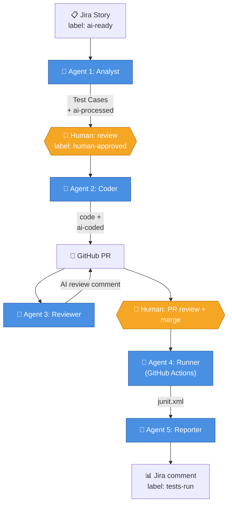

# 📖 Project Guide

Everything you need to operate, configure, extend, and onboard new apps to this framework — in one place.

## Table of Contents

1. [Architecture](#architecture)
2. [The 5 agents in depth](#the-5-agents-in-depth)
3. [The human-approval gate](#the-human-approval-gate)
4. [Branch naming](#branch-naming)
5. [Configuration](#configuration)
6. [Running the pipeline](#running-the-pipeline)
7. [Onboarding a new app](#onboarding-a-new-app)
8. [Troubleshooting](#troubleshooting)

---

## Architecture



For more diagrams — component view, Agent 2 sequence, and the labels-as-state-machine — see [ARCHITECTURE_DIAGRAM.md](./ARCHITECTURE_DIAGRAM.md).

### Key principles

- **Agents communicate via Pydantic schemas.** No raw JSON or freeform strings between agents. See `agents/schemas.py`.
- **Each agent stops at a checkpoint.** A human reviews before the next agent runs. See [the human-approval gate](#the-human-approval-gate).
- **Idempotency via Jira labels.** `ai-processed` (Agent 1 done), `ai-coded` (Agent 2 done), `tests-run` (Agent 5 done). Re-running an agent against an already-processed story is a no-op.
- **Config-driven, not code-driven.** App-specific knowledge (URL, reference files, page inventory) lives in `config.yaml` and `app_inventory/`. Agent code is app-agnostic.
- **Defensive validators.** Between Agent 2's LLM output and the PR, two validators run: filename consistency (matches feature filename to `feature_path()` calls) and step-def coverage (every Gherkin step has a matching `@given/@when/@then`). These catch LLM drift before it reaches a PR.

---

## The 5 agents in depth

### Agent 1: Analyst (`agents/agent1_analyst.py`)

**Role analogy:** Business Analyst / QA Lead.

**What it does:**
1. Reads a Jira story (description + acceptance criteria) — manual mode (`--story KEY`) or scan mode (`--scan` reads selection criteria from config).
2. Calls Gemini with a prompt template (`prompts/agent1_analyst.md` + `prompts/app_context.md`) and a Pydantic schema (`TestCaseList`).
3. For each generated test case, creates a "Test Case" issue in Jira linked to the parent story.
4. Tags the parent story with `ai-processed` (idempotency).

**Inputs:** Jira story key, or JQL-driven scan.
**Outputs:** Jira "Test Case" issues + `ai-processed` label on parent.

**Why this design:**
- Pydantic validation makes malformed LLM JSON fail loudly, not silently.
- Dry-run mode (`--dry-run`) lets you preview without writing to Jira — essential while iterating on prompts.
- The `prompts/app_context.md` block is the ONE place app-specific guidance lives. The main prompt template is app-agnostic.

### Agent 2: Coder (`agents/agent2_coder.py`)

**Role analogy:** SDET (Software Development Engineer in Test).

**What it does:**
1. Reads approved Test Cases from Jira (filtered by `ai-processed` AND `human-approved` labels).
2. Optional dedup check: if any test cases are already covered by existing scenarios, skip them. (`ai-regenerate` label bypasses this.)
3. **Stage 1 (Plan):** Calls Gemini with a Pydantic schema (`CodePlan`) — gets file paths, types, branch name, PR title. NO code yet.
4. **Stage 2 (Generate):** For EACH file in the plan, calls Gemini in text mode to generate the file's content.
5. **Validators:** Checks filename consistency (Phase 4) and step-def coverage (Phase 8). Fails loudly if either is wrong.
6. Creates a branch (`auto/<JIRA-KEY>-<feature-name>`), commits files, opens a PR.
7. Tags the parent story with `ai-coded`.

**Two-stage approach (rationale):**
Asking the LLM for both structure AND large code bodies in one call has high failure rates — the model truncates, hallucinates, or returns malformed JSON. Splitting into a structured "plan" + per-file "text generation" is dramatically more reliable.

**Defensive features:**
- **Reserved paths guard.** Reads `app_under_test.reserved_paths` from config. If the LLM plans to overwrite a reserved file, the run aborts. Prevents the LLM from clobbering your reference test.
- **Branch-name validator.** Every branch must contain a Jira key (so Agent 5 can map back). Validated before pushing.
- **Filename consistency.** If the LLM generates `features/login-validation.feature` but writes `feature_path("login_validation")` (snake/kebab mismatch), Agent 2 auto-corrects (logs the fix) or fails loudly if the correction is ambiguous. See [ADR-009](./ADR-009-deduplication.md) for details.
- **Step-def coverage.** Pairs each generated `.feature` with its `tests/step_defs/test_*.py` and verifies every Gherkin step has a matching `@given/@when/@then`. Hard-fails if any step is uncovered.

**Regeneration mode:**
Add label `ai-regenerate` to a parent story. Agent 2 will:
- Skip the dedup check
- Create a branch with `-rev2/-rev3/...` suffix
- Open a fresh PR
- Remove `ai-regenerate` after success (one-shot signal)
- The original PR stays open as historical record (close it manually)

### Agent 3: Reviewer (`agents/agent3_reviewer.py`)

**Role analogy:** Senior Engineer doing code review.

**What it does:**
1. Reads PR metadata + changed files via PyGithub.
2. Calls Gemini with a rigorous review prompt (`prompts/agent3_reviewer.md`) plus the reference files for style baseline.
3. Post-processes the response: deduplicates issues (Gemini sometimes loops on low-content PRs) and caps at 10 issues.
4. Posts a markdown comment on the PR.

**Triggers:**
- Local: `python -m agents.agent3_reviewer --pr <N>`
- CI: `.github/workflows/agent3-reviewer.yml` runs on PR open/synchronize/reopen

**Why post-process instead of constraining the schema?**
Pydantic's `max_length=10` translates to JSON Schema `maxItems`, which Gemini's constrained-decoding engine cannot compile on complex object arrays (it errors with "too many states for serving"). So we let the LLM produce an unbounded list and trim it deterministically in Python after.

**Anti-hallucination guardrails (built into the prompt):**
- Every issue must quote a specific line from the diff
- "When unsure, approve" — false positives erode trust
- Never speculate about caller behavior you can't see in the diff
- Never flag exception-raising as a bug unless the caller is in the diff and fails to handle it

### Agent 4: Runner

**Implementation:** `.github/workflows/agent4_runner.yml` (no Python module).

**Why no `.py` file?** Agent 4's job is "run pytest, parse junit.xml, upload artifacts." Zero LLM calls, zero API decisions. Wrapping shell commands in Python would be needless indirection. The workflow file is Agent 4 — full stop.

**What the workflow does:**
1. Checks out the PR branch
2. Installs Python deps and Playwright (with browser caching for speed)
3. Runs `pytest` with JUnit XML + HTML output
4. Uploads `reports/` as a workflow artifact (so Agent 5 can read it in the next job)
5. Writes a markdown test summary to the GitHub Actions job summary page

**Triggers:** PR opened, synchronized (new commits), reopened. Plus manual `workflow_dispatch`.

**Why combined with Agent 5 in one workflow?** GitHub Actions has a quirk: workflows triggered by `workflow_run` (cross-workflow) don't appear as PR checks. Combining Agent 4 + Agent 5 into one workflow with two jobs gives both visibility on the PR. Trade-off: Agent 5's check shows as "Agent 4 - Runner / Post Results to Jira" instead of "Agent 5 - Reporter / Post Results to Jira" — cosmetic only.

### Agent 5: Reporter (`agents/agent5_reporter.py`)

**Role analogy:** QA Lead writing a test results summary.

**What it does:**
1. Parses `reports/junit.xml` (produced by Agent 4) into a `RunReport`.
2. Enriches with CI context: PR URL, workflow run URL, commit SHA, link to artifact download.
3. Calls Gemini with a structured schema (`JiraCommentDraft`) to produce ONLY the prose summary (Python adds the deterministic links/metadata after).
4. Posts the comment to the parent Jira story (resolved from PR branch name).
5. Tags the story with `tests-run`.

**Why Python builds the deterministic parts:**
LLMs are bad at conditional rendering (`if PR_URL exists, include link`). Even with explicit instructions, they include "View PR (None)" or similar when fields are unavailable. Splitting prose (LLM) from facts (Python) eliminates this entire class of bugs.

**Story key resolution priority:**
1. `--story` CLI arg (explicit)
2. `JIRA_STORY_KEY` env var
3. Parsed from PR branch name (any `PROJ-123` pattern, regardless of prefix)
4. Skip cleanly (exit 0) if no key found — non-AI PRs don't get reports

---

## The human-approval gate

The architectural answer to "AI is fast but imperfect — how do we keep humans in control of cost and quality without slowing the system to a crawl?"

### End-to-end flow

```
[1] Parent Story (e.g., SCRUM-5 "Login functionality")
       label: ai-ready
              ↓
[2] Agent 1 reads it
       - Generates 5–8 manual test cases
       - Creates linked Jira "Test Case" issues
       - Marks parent story:  label: ai-processed
              ↓
[3] HUMAN REVIEW  ← THE GATE
       - You open the parent story on Jira
       - Read each linked Test Case issue
       - Approve, edit descriptions, or reject (label: ai-skip)
       - When happy:        label: human-approved   (one click)
              ↓
[4] You click "Run workflow" on `Agent 2 - Coder` in GitHub Actions
       (OR scheduled trigger fires later)
              ↓
[5] Agent 2 runs (in CI)
       - Selects: stories with ai-processed AND human-approved
                  AND NOT ai-coded AND NOT ai-skip
       - For each: reads linked Test Cases → generates Playwright code
       - Opens PR
       - Marks parent story:  label: ai-coded
              ↓
[6] Agents 3 (Reviewer) + 4 (Runner) + 5 (Reporter) cascade
       (already automated via workflow files)
```

### Why a gate at all?

Test cases are where the most expensive bad decisions happen. A bad test case → wasted LLM tokens on Agent 2 → broken PR → engineer time debugging. Cost of catching a bad test case BEFORE Agent 2 runs: 1 minute of human review. Cost AFTER: ~30 minutes of code review + cleanup.

The gate is between Agents 1 and 2 specifically because that's the highest-leverage checkpoint. Catching errors earlier is cheaper than catching them later.

### Label semantics

| Label | Meaning | Set by |
|---|---|---|
| `ai-ready` | "Process this story with Agent 1" | Human |
| `ai-processed` | "Agent 1 finished, Test Cases created" | Agent 1 |
| `human-approved` | "I reviewed the Test Cases and approve" | Human |
| `ai-skip` | "Don't process this story (override)" | Human |
| `ai-coded` | "Agent 2 finished, PR is open" | Agent 2 |
| `ai-regenerate` | "Regenerate code for this story (one-shot)" | Human |
| `tests-run` | "Agent 5 posted test results" | Agent 5 |

---

## Branch naming

Agent 2 generates branches in the form:

```
auto/<JIRA-KEY>-<feature-name>
```

Examples:
- `auto/SCRUM-5-login-validation`
- `auto/PROJ-123-cart-checkout`

### Why this convention

The Jira key in the branch name is **load-bearing**: Agent 5 extracts it via regex to know which Jira story to post results to. Without a key, Agent 5 can't close the loop — so it skips (gracefully, not as an error).

The regex is in `config/__init__.py`:
```python
JIRA_KEY_PATTERN = re.compile(r"\b([A-Z][A-Z0-9_]*-\d+)\b")
```

Works for any project prefix: `SCRUM-1`, `PROJ-123`, `MOBILE-42`, `BACKEND-5678`, etc.

### What the validator enforces

`config.assert_valid_branch_for_pipeline(branch_name)` raises `InvalidBranchNameError` if no key is found. Agent 2 calls this before pushing — better to fail BEFORE creating a branch than to discover the gap downstream.

For ad-hoc human branches without a key (e.g., `feature/foo`): Agent 5 detects the missing key, logs a warning, and exits 0. The PR still gets normal CI but no Jira comment.

---

## Configuration

### Environment variables (`.env`)

| Variable | Required | Used by | Notes |
|---|---|---|---|
| `JIRA_URL` | yes | All Jira-touching agents | e.g., `https://yoursite.atlassian.net` |
| `JIRA_EMAIL` | yes | Same | Your Jira account email |
| `JIRA_API_TOKEN` | yes | Same | Create at id.atlassian.com → Security → API tokens |
| `JIRA_PROJECT_KEY` | yes | Same | e.g., `SCRUM`, `PROJ` |
| `JIRA_BOARD_ID` | no* | Agents 1, 2 (scan) | Numeric board ID. *Required only when config.yaml uses `sprint: "auto"`. Find it in the board URL: `.../boards/<ID>` |
| `OPENAI_API_KEY` | yes | All agents (LLM) | Your LLM provider's API key |
| `OPENAI_API_BASE` | yes | Same | Base URL of your OpenAI-compatible API endpoint |
| `LLM_MODEL` | no | Same | Defaults to `claude-opus-4-6`. Set to your model name |
| `GITHUB_TOKEN` | yes | Agents 2, 3 | PAT with `repo` scope |
| `GITHUB_REPO` | yes | Same | `<owner>/<repo>` format |
| `BASE_URL` | no | Tests at runtime | Override `config.yaml`'s base_url |
| `PLAYWRIGHT_HEADLESS` | no | conftest | `true`/`false` — overrides config.yaml |
| `JIRA_STORY_KEY` | no | Agent 5 | Manual override for story resolution |
| `PR_NUMBER` | no | Agents 3, 5 | Manual override for PR detection |

Validation: every agent calls `validate_required_env(...)` at startup. Missing vars produce a clear `MissingEnvVarError` listing ALL missing names — not just the first.

### `config.yaml` structure

```yaml
app_under_test:        # The application being tested (the SINGLE decoupling point)
  name: ...
  base_url: ...
  inventory_file: ...
  reference_files:     # files Agent 2/3 use as the style baseline
    feature: ...
    step_def: ...
    page_object: ...
  reserved_paths:      # files Agent 2 must NEVER overwrite
    - ...

browser:               # Playwright settings (headless, viewport, timeout, slow_mo)

base_url: ...          # Legacy alias for tests/conftest.py

test_users: ...        # SauceDemo-specific test data (move/remove for other apps)

agents:
  agent1_analyst:
    selection: { ... } # JQL filter for --scan mode
    completion_label: ...
    max_stories_per_run: ...

  agent2_coder:
    selection: { ... }
    regenerate_selection: { ... }   # for ai-regenerate flow
    completion_label: ...
    regenerate_label: ...
    max_stories_per_run: ...
```

### Sprint scoping

Every scan (Agent 1 and all three Agent 2 passes) is scoped to a sprint via
the `sprint:` key present in each selection block:

| Value | Behavior |
|---|---|
| `"auto"` *(default, recommended)* | Resolves the currently **active** sprint from Jira at runtime via `JIRA_BOARD_ID`. **Zero config changes at sprint boundaries** — when your Scrum master starts Sprint 11, the scans follow automatically. Degrades gracefully: if the board ID is missing or no sprint is active, a warning is logged and the scan spans all sprints. |
| `"openSprints"` | Uses Jira's `sprint in openSprints()` JQL alias. Same effect as auto but needs no board ID; the resolved sprint name won't appear in logs. |
| `"Sprint 10"` | Exact sprint name — pin scans to one specific sprint (useful for retro analysis or parallel-sprint boards). |
| *(key omitted)* | No sprint filter; scans across all sprints (pre-sprint-scoping behavior). |

One-off overrides without editing config: `--sprint "Sprint 10"` on the CLI
(`python -m agents.agent1_analyst --scan --sprint "Sprint 10"`), or the
`sprint` input in the GitHub Actions "Run workflow" dialog. Priority:
CLI/workflow input > config.yaml > no filter.

Finding your board ID: open your board in Jira; the URL contains
`.../jira/software/projects/<KEY>/boards/<ID>` — that number is `JIRA_BOARD_ID`.

### CI secrets

For GitHub Actions, set the same names listed above under repo Settings → Secrets and variables → Actions. The workflows reference them via `${{ secrets.NAME }}`. Add `JIRA_BOARD_ID` as a secret if using `sprint: "auto"`.

---

## Running the pipeline

### Local dev (one story at a time)

```bash
# 1. Generate test cases
python -m agents.agent1_analyst --story SCRUM-5 --dry-run    # preview
python -m agents.agent1_analyst --story SCRUM-5              # commit to Jira

# 2. Approve in Jira (add label: human-approved)

# 3. Generate code + open PR
python -m agents.agent2_coder --story SCRUM-5 --dry-run      # preview
python -m agents.agent2_coder --story SCRUM-5                # opens real PR

# 4. Agents 3, 4, 5 run automatically when the PR opens (via GitHub Actions)
#    Or trigger manually:
python -m agents.agent3_reviewer --pr 12 --dry-run
python -m agents.agent5_reporter --story SCRUM-5 --reports-dir reports/ --dry-run
```

### Scan mode (production)

```bash
python -m agents.agent1_analyst --scan        # processes all stories with ai-ready label
python -m agents.agent2_coder --scan          # processes all approved stories
```

Selection rules come from `config.yaml`'s `agents.<name>.selection` block.

### CI cascade

Once you merge the PAT cascade setup (see [ADR-008](./ADR-008-pat_for_cascade.md)), pushing a `human-approved` label to a story can auto-trigger Agent 2 in CI. Otherwise, you trigger Agent 2 manually via "Run workflow" on the Actions tab.

---

## Onboarding a new app

The whole point of the recent refactor: **no Python code changes** to point this at a different application. Here's the full step-by-step.

### Step 1: Edit `config/config.yaml` — `app_under_test` block

```yaml
app_under_test:
  name: "MyShopApp"
  base_url: "https://myshop.example.com"
  inventory_file: "app_inventory/myshop.json"
  reference_files:
    feature: "features/cart.feature"            # your reference test
    step_def: "tests/step_defs/test_cart.py"
    page_object: "pages/cart_page.py"
  reserved_paths:
    - "features/cart.feature"
    - "tests/step_defs/test_cart.py"
    - "pages/cart_page.py"
    - "pages/base_page.py"
    # Add any other "do not touch" files
```

### Step 2: Create `app_inventory/myshop.json`

Describes the pages, selectors, and methods of your app. Use `app_inventory/saucedemo.json` as the example. The schema is documented in [APP_INVENTORY_SCHEMA.md](./APP_INVENTORY_SCHEMA.md).

### Step 3: Replace `prompts/app_context.md`

Put your app's known users, error messages, page flow notes, and anything else the analyst should know. This file gets injected into Agent 1's prompt.

### Step 4: Author one reference test

Write ONE high-quality, hand-crafted Playwright + pytest-bdd test for a representative flow in your app. This becomes the "style baseline" for Agent 2 (mimic) and Agent 3 (compare against).

The reference triplet is:
- `features/<reference>.feature` — Gherkin
- `tests/step_defs/test_<reference>.py` — step definitions
- `pages/<reference>_page.py` — page object

### Step 5: Optional — clean up SauceDemo leftovers

If you want a pristine repo for your app (no SauceDemo files):
- Delete `app_inventory/saucedemo.json`
- Delete `features/login.feature`, `tests/step_defs/test_login.py`, `pages/login_page.py`, `pages/inventory_page.py`
- Update `config.yaml`'s `test_users:` block (or remove it)
- Update `config.yaml`'s `base_url:` legacy alias

### Step 6: Test locally

```bash
python scripts/smoke_test.py           # verifies env + Jira + Gemini + Playwright
pytest tests/step_defs/test_<your_reference>.py -v   # runs your reference test

# Then with a real Jira story:
python -m agents.agent1_analyst --story <YOUR-KEY> --dry-run
```

If the dry-run output looks good for your app, you're ready to go.

### What you do NOT need to change

- ❌ Any Python file in `agents/`
- ❌ `config/__init__.py` or `config/paths.py`
- ❌ Any prompt template (`prompts/agent*.md`) — those use `{app_name}` and `{reference_*}` placeholders that read from config
- ❌ Any GitHub Actions workflow file
- ❌ Any test in `tests/unit/`

If the refactor was done correctly, app-onboarding is purely a config/data exercise.

---

## Troubleshooting

### `MissingEnvVarError: Missing required environment variable(s): ...`

You forgot to fill in `.env` (or in CI, set the secret). Fix by copying `.env.example` to `.env` and filling in real values. The error message lists every missing name at once — fix all of them in one go.

### `RuntimeError: JiraClient: missing required env var(s): JIRA_URL, ...`

Same as above but raised by `JiraClient` directly. Means the env-var validation didn't run before the agent reached `JiraClient`. Should not happen with the refactored code, but can if you call `JiraClient()` directly without going through `main()`.

### `QuotaExhaustedError: LLM API rate limit / quota exhausted...`

Your LLM provider's rate limit or quota has been reached. Options:
1. Wait for the rate limit to reset
2. Switch `LLM_MODEL` in `.env` to a different model
3. Check your API plan limits with your provider

### Jira `enhanced_search_issues` not found

You're on an old `jira` package version. Atlassian removed the legacy `/rest/api/2/search` endpoint. Upgrade:
```bash
pip install --upgrade jira
```
Requires `jira>=3.10.5`.

### `StepDefinitionNotFoundError` at test collection

Agent 2's coverage validator should catch this BEFORE the PR is created. If a PR still slips through with this error:
- Check the Agent 2 logs for "Step definition coverage check FAILED"
- Look for an empty quoted value in a Gherkin scenario without a matching `parsers.re()` decorator
- The validator can occasionally miss edge cases — file an issue with the failing scenario

### Filename mismatch (`FileNotFoundError` for a `.feature` file at collection)

Same as above — Agent 2's filename validator catches most of these. If one slips through, check Agent 2 logs for "Auto-correcting filename mismatch" or "Filename consistency error".

### Agent 5 doesn't post a comment

Most common cause: PR branch doesn't contain a Jira key. Agent 5 extracts the story key from the branch name (e.g., `auto/SCRUM-5-foo` → `SCRUM-5`). Branches without a key cause Agent 5 to skip cleanly with a warning log. Manual fix: pass `--story KEY` explicitly, or rename the branch.

### `LLM returned None — could not produce valid <Schema>`

Gemini's structured-output mode failed. Two common causes:
1. A safety filter blocked the response (rare with code/test content)
2. The Pydantic schema has a feature Gemini can't compile (e.g., regex pattern, complex `maxItems`)

Check the schema for any constraints beyond the basics (Literal, default, min_length on lists). Per `agents/schemas.py` notes, avoid `max_length` on lists of complex objects.
